# 05. Целевая модель системы учёта договоров (TO-BE)

**Цель документа:** задать реализуемую целевую модель данных, статусов, процесса и пользовательских пространств, которая закрывает норматив TARGET и сохраняет доказуемую миграционную связь с текущим CODE.

**Дата анализа:** 2026-08-17. **Решения синхронизированы:** 2026-08-18.

**Источник истины:** для требуемого результата — `Structure of the contract accounting system.md` (TARGET); для исходной реализованной модели — текущий working tree `Вспомогательные/Claude ferum_custom/apps/ferum_custom`; утверждённые owner decisions — [08_open_questions.md](08_open_questions.md). Решения TO-BE не являются утверждением о наличии функций в CODE.

**Как проверить:** сопоставить решения с атомарными требованиями в [04_coverage_matrix.csv](04_coverage_matrix.csv), исходное состояние — с [03_asis_model.md](03_asis_model.md), утверждённые/открытые решения — с [08_open_questions.md](08_open_questions.md); после реализации связать инкременты из [06_roadmap.md](06_roadmap.md) и прогнать критерии [09_verification_report.md](09_verification_report.md).

## 1. Архитектурное решение

TARGET требует единого корня договора, независимых юридического и операционного состояний, явных обязательств, доказуемой цепочки план → факт → документ → деньги и универсального процессного слоя (`Structure of the contract accounting system.md:L44-L85`, `Structure of the contract accounting system.md:L188-L225`, `Structure of the contract accounting system.md:L582-L627`, `Structure of the contract accounting system.md:L820-L864`).

Целевая модель закрепляет следующее:

1. `Ferum Service Project` — единый корневой агрегат исполняемого договора и SSOT юридических условий, сторон, срока, цены, изменений, обеспечений, `legal_status` и `execution_status`. Это прямое следование нормативному правилу «один Service Project = один исполняемый договор».

2. Текущие `Ferum Contract` и `Ferum Project Contract Link` — переходные AS-IS сущности: новые записи после cutover в них не создаются, однозначные данные сливаются в `Ferum Service Project`, а неоднозначные N:M-связи блокируют автоматическую миграцию и попадают в exception report. Эта рекомендация OQ-CA-001 утверждена 2026-08-18; отдельный Contract-root не входит в принятую модель.

3. `Ferum Contract Requirement` хранит извлечённое условие источника; `Ferum Contract Obligation` — нормализованное обещание «что, где, когда и с каким результатом»; `Ferum Project Scope` — повторяемое операционное правило генерации работ; `Ferum Project Process Step` — однократное действие. Эти сущности не взаимозаменяемы (`Structure of the contract accounting system.md:L1326-L1351`, `Structure of the contract accounting system.md:L2240-L2283`).

4. BPM оркестрирует работу, но не подменяет Workflow, permissions и серверную валидацию бизнес-документов. `Ferum Project Process Step` — процессный SSOT, а персональные поручения создаются стандартными `Assignment`/`ToDo` (`Structure of the contract accounting system.md:L1164-L1192`, `Structure of the contract accounting system.md:L2049-L2076`).

5. Факт обнаружения (`Ferum Finding`), поручение на устранение (`Ferum Service Request`), факт обследования (`Ferum Inspection`) и выполненный визит (`Ferum Maintenance Visit`) разделены. Это сохраняет причинность и позволяет одному выявленному отклонению породить несколько действий (`Structure of the contract accounting system.md:L350-L394`, `Structure of the contract accounting system.md:L1582-L1642`).

6. `Ferum Project Document` — единый реестр договорных и исполнительных документов, но `Ferum Billing Artifact` остаётся специализированным файловым lifecycle закрывающих документов; общий реестр ссылается на него, не дублируя файл (`Structure of the contract accounting system.md:L398-L435`, `Structure of the contract accounting system.md:L1920-L1943`).

### 1.1. Основание миграционного решения

В текущем Claude CODE уже существуют отдельные `Ferum Contract` и `Ferum Project Contract Link`; переходы контракта реализованы контроллером, а зеркала юридических полей проекта синхронизируются сервисом (`Вспомогательные/Claude ferum_custom/apps/ferum_custom/ferum_custom/ferum_custom/doctype/ferum_contract/ferum_contract.py:L180-L243`, `Вспомогательные/Claude ferum_custom/apps/ferum_custom/ferum_custom/services/contract_mirror_sync.py:L73-L92`, `Вспомогательные/Claude ferum_custom/apps/ferum_custom/ferum_custom/services/contract_mirror_sync.py:L147-L176`). Поэтому переход выполняется по схеме expand → backfill → dual-read/compare → cutover → запрет записи → архивирование legacy, без удаления исходных записей. Архитектурное решение OQ-CA-001 утверждено; cutover каждой неоднозначной строки остаётся заблокирован MG-CA-001 до подписанного disposition.

Текущий `Ferum Contract.status` и `Ferum Service Project.project_status` не являются целевой парой `Ferum Service Project.legal_status`/`execution_status` (`Вспомогательные/Claude ferum_custom/apps/ferum_custom/ferum_custom/ferum_custom/doctype/ferum_contract/ferum_contract.json#status`, `Вспомогательные/Claude ferum_custom/apps/ferum_custom/ferum_custom/ferum_custom/doctype/ferum_service_project/ferum_service_project.json#project_status`). По owner decisions от 2026-08-18 существующие records являются тестовыми, не мигрируются и могут быть reset/recreate; раздел 4 задаёт clean TARGET FSM.

## 2. Действия над существующими DocType

Обозначения: **оставить** — не менять семантическую роль; **расширить** — добавить поля/связи; **перепривязать** — сменить юридический родитель; **представление** — не быть SSOT; **упразднить поле** — сохранить на миграционный период только для чтения. Таблица охватывает все 54 существующих Claude DocType. Точный типизированный AS-IS baseline каждого поля и Link/Table приведён в [03_asis_model.md](03_asis_model.md#сущности-и-ключевые-поля); ниже указаны целевое действие и ключевая дельта. Запись `field:Type` нормативна; групповые слова без двоеточия описывают существующую группу полей из AS-IS, а не создают поле с неуказанным типом. Полный data dictionary всех добавляемых полей является обязательным DoR раздела 11.

| DocType | Назначение и тип | Решение TO-BE | Ключевые поля и связи после изменения | Naming | Основные роли |
| --- | --- | --- | --- | --- | --- |
| `Ferum Contract` | Текущая юридическая карточка, parent | **Объединить с Service Project и упразднить как активный SSOT**; оставить read-only legacy до завершения retention | все юридические поля и исходный идентификатор переносятся/ссылаются в `Ferum Service Project`; неоднозначность фиксируется exception, запись после cutover запрещена | существующее имя сохраняется только как migration key | System Manager migration; Юрист/аудит R legacy |
| `Ferum Service Project` | Единый исполняемый договор, parent | **Расширить**, юридический и операционный SSOT | существующие `company/customer:Link`, номер/дата/предмет, суммы/VAT/procurement/payment/security/SLA; добавить `legal_status:Select`, `execution_status:Select`, `launch_date:Date`; `financial_plan:Table`; связанные parent Amendment/Security/Execution Stage/Requirement/Obligation/Process/Object/Scope/Fact/Document/Finance доступны обратными Links, а не Table | существующая `FSP-.YYYY.-.#####`; unique `(company, contract_number, contract_date)` с управляемым исключением | Юрист legal CRUD; Руководитель проектов status/approve; Менеджер проектов execution CRUD; Бухгалтер finance; Генеральный директор approve/read; System Manager admin |
| `Ferum Project Contract Link` | Текущая N:M связь, parent/link entity | **Упразднить после миграции** | использовать только как source mapping `contract → service_project`; новые связи запрещены; N:M и несколько primary уходят в утверждённый exception-процесс OQ-CA-001/MG-CA-001 | существующее имя как audit key | System Manager migration; Юрист/аудит R legacy |
| `Ferum Contract Amendment` | Изменение договора, parent | **Перепривязать** к Service Project | обязательный `service_project`; `amendment_number/date`, `effective_from`, `change_type`, `status`, `source_document`; structured change rows | `FCAmd-.YYYY.-.#####` | Юрист CRUD; Генеральный директор approve; Руководитель проектов R |
| `Ferum Contract Execution Stage` | Юридико-финансовый этап, parent | **Перепривязать** к Service Project | `service_project`, `stage_number`, period, amount, acceptance/billing/payment dates, `status`; Link Billing Cycle/Outputs | `FCES-.YYYY.-.#####` | Юрист CRUD; Бухгалтер CRUD finance; Руководитель проектов R |
| `Ferum Contract Security` | Обеспечение заявки/исполнения/гарантии, parent | **Перепривязать** к Service Project | `service_project`, `security_type`, amount, issue/expiry/return dates, provider, document, `status`, reminders | `FCS-.YYYY.-.#####` | Юрист CRUD; Бухгалтер CRUD; Генеральный директор R |
| `Ferum Contract Financial Plan Row` | Строка плана, child | **Оставить**, сделать Table у Service Project | period, revenue plan, cost plan, cash-in/out plan, tax plan, source stage; не самостоятельный ledger | child hash | редактирование Бухгалтер/Руководитель проектов; денежные поля с permlevel |
| `Ferum Service Object` | Справочник физических площадок, parent | **Оставить и расширить** | customer/owner, address, geo, access/contact attributes, risk class; Links systems and Service Project bindings | `FSO-.#####` | Менеджер проектов CRUD; Инженер R; Заказчик portal R permitted |
| `Ferum Project Object` | Effective-dated привязка объекта к договору-проекту, parent | **Оставить** | `service_project`, `service_object`, `effective_from/to`, amendments, status; unique active interval per context | существующая серия | Юрист dates R/U; Менеджер проектов CRUD; Инженер R |
| `Ferum Object System` | Инженерная/противопожарная система объекта, parent | **Оставить и расширить** | `service_object`, `system_type`, manufacturer/model, commissioning date, condition, criticality, equipment count, responsible party | `FOS-.#####` | Менеджер проектов CRUD; Инженер CRUD technical; Подрядчик limited R |
| `Ferum External Object Reference` | Внешние идентификаторы объекта, parent | **Оставить** | `service_object`, source system, external id, valid dates, metadata | `FEOR-.#####` | Integration/System Manager CRUD; Менеджер проектов R |
| `Ferum Project Scope` | Повторяемое правило обслуживания, parent | **Расширить**, не использовать вместо Obligation | добавить `contract_obligation:Link`; существующие Project Object/Object System/Work Type/frequency/SLA/effective dates; responsibility policy | `FPSCOPE-.#####` | Менеджер проектов CRUD; Руководитель проектов approve; Инженер R |
| `Ferum Maintenance Schedule` | Плановая строка/период выполнения, parent | **Расширить** | добавить `contract_obligation:Link`; существующие `project_scope:Link`, frequency/start/end/calendar/status; `period_key:Data`, `planned_team:Table`; generates/links visits | существующая серия | Менеджер проектов CRUD; Инженер R; Подрядчик limited R |
| `Ferum Maintenance Visit` | Факт выезда/ТО, parent | **Расширить** | obligation/schedule, project/object/system, actual start/end, performers, acceptance status, checklist snapshot, linked findings, evidence, work result, billing eligibility | существующая серия | Инженер CRUD; Менеджер проектов approve; Подрядчик limited CRUD assigned; Заказчик portal acceptance |
| `Ferum Visit Checklist Item` | Снимок пункта проверки, child | **Оставить** | template item ref, text snapshot, result, measured value, comment, evidence, finding | child hash | наследует права Visit |
| `Ferum Checklist Template` / `Ferum Checklist Template Item` | Версионируемый технический чек-лист, parent/child | **Расширить** | system/work type, version/status/effective dates; item evidence requirement, finding rule, inspection applicability | `FCT-.#####`; child hash | Руководитель проектов approve; Инженер draft/use |
| `Ferum Service Request` | Поручение/заявка на действие, parent | **Оставить и расширить** | source type/name, optional `finding`, obligation, project/object/system, request type, SLA, assignee, status, resolution, work result/evidence | существующая серия | Менеджер проектов CRUD; Инженер/Подрядчик assigned CRUD; Заказчик portal create/read |
| `Ferum Photo Evidence` | Специализированная фотофиксация, parent | **Оставить**, включать через Process Evidence | file, timestamp, author, object/system, source doctype/name, geo/hash where required; Link `process_evidence` | существующая серия | автор create; Менеджер проектов/контролёр R; запрет незаметной замены файла |
| `Ferum Billing Output` | Бизнес-сущность акта/УПД/счёта, parent | **Расширить** | service project/period, output type, lifecycle, amount, invoice link; Table immutable Billing Basis Item с Visit/Request/other result | существующая серия | Бухгалтер CRUD; Юрист/RP approve/read |
| `Ferum Billing Artifact` | Файловый lifecycle закрывающего документа, parent | **Оставить**, отображать в общем реестре | billing output, artifact type/version/file/hash/signature/status; Link `project_document` registry projection | существующая серия | Бухгалтер CRUD; Юрист R; Заказчик portal allowed |
| `Ferum Billing Event` | Неизменяемое событие billing lifecycle, parent/log | **Оставить** | output/artifact, event type/time/actor, payload/hash | hash/series | system create; Audit/Бухгалтер R |
| `Ferum Project Finance Summary` | Финансовый read-model, parent | **Оставить как представление** | service project, invoiced, paid, receivable, costs, margin, profitability, updated_at; только derived upstream | project-key | Бухгалтер/RP/ГД R; system update |
| `Ferum Contractor Settlement` | Расчёты с подрядчиком, parent | **Оставить**, не использовать как Assignment | supplier, assignment/project/period, accrued, paid, payable, status; Links Purchase Invoice/Payment Entry | существующая серия | Бухгалтер CRUD; Руководитель проектов R |
| `Ferum Service Project Line` | Коммерческая строка договора, parent | **Оставить и защитить Amendment** | `service_project:Link`; `item:Link`; `qty:Float`; `uom:Link`; `rate/amount:Currency`; добавить `contract_obligation:Link` и effective version/provenance; после активации правки только через Amendment | существующая серия | Менеджер проектов draft; Юрист/RP approve; Бухгалтер R |
| `Ferum Material Expense` | Операционная стоимость материалов, parent | **Оставить как adjunct**, не создавать второй склад/ledger | текущие Links Project/Object/Visit/Request/Item/Supplier/Purchase Invoice/Stock Entry; добавить `contract_obligation:Link`, `contractor_assignment:Link`; amount остаётся Currency snapshot | существующая серия | Менеджер/Инженер create; Бухгалтер verify; RP R |
| `Ferum Incoming Invoice` | Intake входящего счёта, parent | **Оставить как intake/approval**, standard Purchase Invoice — SSOT | сохранить party/project/cost target, amount/VAT/currency, approval; добавить Links Assignment/Obligation/Project Document; запрет собственного GL | существующая серия | Бухгалтер CRUD; approver по Workflow; RP R |
| `Ferum Incoming Invoice Payment Allocation` | Сверка оплаты входящего счёта, parent | **Оставить** | Links Incoming Invoice/Payment Entry/Purchase Invoice, `allocated_amount:Currency`, reversal Link; добавить `contractor_assignment:Link` при подрядной оплате | существующая серия | Бухгалтер CRUD; Audit R |
| `Ferum Advance Allocation Assistant` | Временный помощник распределения аванса, parent | **Оставить как transient orchestration** | Company/Customer/Payment Entry Links, preview JSON, status; результат только через стандартные allocation records | существующая серия | Бухгалтер CRUD; System Manager support |
| `Ferum Advance Allocation Log` | Неизменяемый журнал распределения, parent/log | **Оставить** | Assistant/Payment Entry/Sales Invoice Links, allocated amount, actor/time, hash; update/delete запрещены после apply | существующая серия | system create; Бухгалтер/Audit R |
| `Ferum Opening Receivable` | Миграционный ввод дебиторки, parent | **Оставить только для controlled migration** | Customer/Project/Currency Links, dates/amount/dedup key; создаёт standard Sales Invoice, после migration read-only | существующая серия | Migration role CRUD; Бухгалтер approve/read |
| `Ferum Opening Payable` | Миграционный ввод кредиторки, parent | **Перепривязать** с legacy Contract на Service Project и оставить migration-only | Supplier/Service Project/Currency Links, dates/amount/dedup key; standard Purchase Invoice — результат/SSOT | существующая серия | Migration role CRUD; Бухгалтер approve/read |
| `Ferum Reconciliation Log` | Журнал расхождений, parent/log | **Оставить и расширить** | typed source scope, difference amount, status/details/time; добавить Dynamic Links source/target и resolution evidence; immutable after resolution | существующая серия | system create; Бухгалтер/Audit resolve/read |
| `Ferum Customer Unit` | Организационная единица Customer, parent | **Оставить как расширение standard Customer** | Customer/parent unit/Contact Links, code/address/region/status; не дублировать party SSOT | существующая серия | Менеджер проектов CRUD; Customer master owner approve |
| `Ferum Customer Tax Profile` | Налоговый профиль подразделения Customer, parent | **Оставить как extension** standard Customer | Customer Link, KPP/address/validity/status; добавить `party_identity:Link` и reconciliation state без автосоздания/перезаписи Customer | существующая серия | Бухгалтер/Юрист CRUD; Audit R |
| `Ferum Party Identity` | Cross-master identity/linkage, parent | **Оставить как reconciliation layer**, не master SSOT | Links Customer/Supplier/Company/head party, identifiers, duplicate/reconciliation state, provenance; idempotent link; no ambiguous auto-merge и no default bidirectional business-field sync по OQ-CA-017 | существующая серия | Master Data Steward CRUD; Юрист/Бухгалтер approve; Audit R |
| `Ferum Party Tax Registration` | Регистрация/KPP стороны, child | **Оставить** у Party Identity | `kpp:Data`, branch/address, `valid_from/to:Date`, `is_primary:Check`; overlap validation | child row | наследует Party Identity |
| `Ferum Company Tax Account` | Конфигурация налогового Account, child | **Оставить** с `purpose=Output VAT/Input VAT` | `account_head:Link Account`, `purpose:Select`, `enabled:Check`; standard ERPNext accounting documents/Account/GL остаются SSOT, custom ledger/correction GL запрещены | child row | наследует Company Document Settings; Бухгалтер edit |
| `Ferum Company Document Settings` | Настройки печати/документов Company, parent | **Оставить и связать с Project Document** | Company/Bank Account/Letter Head/Print Format Links, Tables signers/tax accounts; добавить document policy/version Links | `field:company` | Бухгалтер/Юрист CRUD; System Manager configure |
| `Ferum Company Signer` | Полномочия подписанта, child | **Оставить и усилить validity** | name/position/basis, valid dates, default/signature; добавить `employee/contact:Link`, authority document Link Project Document | child row | наследует Company Document Settings; Юрист approve |
| `Ferum Legal Number Counter` | Атомарный счётчик номера, parent | **Оставить как infrastructure** | Company/Fiscal Year Links, `series_type:Select`, `next_number:Int`; расширять только для Project Document policy, блокировка выдачи server-side | текущий key | system write; Бухгалтер/Юрист read |
| `Ferum Document Generation Job` | Очередь генерации billing-файла, parent | **Оставить специализированным** | Billing Output/previous job/File Links, mode/status/retries/timestamps; добавить Project Document projection Link, idempotency/hash | существующая серия | system create/update; Бухгалтер retry/read |
| `Ferum Approval Delegation` | Делегирование утверждений, parent | **Оставить и распространить на Gates/BPM** | delegator/delegate Links, scope/valid dates/status; добавить `scope_doctype:Link DocType`, `scope_name:Dynamic Link`, запрет self-approval и audit evidence | существующая серия | делегатор request; authorized approver approve; Audit R |
| `Ferum File Access Policy` | Политика доступа к File, parent | **Оставить и вернуть доказуемую ссылочность** | source DocType/name, role/user, permission/status; по утверждённому OQ-CA-019 использовать Dynamic Link для active policy/lock, guarded Data + immutable snapshot — только для append-only audit/notification log | существующая серия | Security/System Manager CRUD; Audit R |
| `Ferum Project Completion Exception` | Контролируемое исключение закрытия, parent | **Оставить и связать с Gate** | Service Project Link, type/reason/status/approval/validity; добавить Stage Gate/criterion Links, evidence, expiry action | существующая серия | Менеджер request; RP/Director approve; Audit R |
| `Ferum Settings` | Single-настройки приложения, parent | **Расширить без бизнес-данных** | текущие SLA/maintenance flags; добавить default calendar/timezone, process engine horizon, feature gates и policy Links; значения versioned/audited | Single | System Manager configure; Process Owner/Бухгалтер R relevant |
| `Ferum Tool` | Карточка инструмента, parent | **Оставить** | Item/current holder/Project Links, code/serial/status; добавить optional Assignment/Object Link, не заменять standard Asset при asset accounting | `field:tool_code` | Кладовщик CRUD; инженер/подрядчик R assigned |
| `Ferum Tool Movement` | Неизменяемое движение инструмента, parent/log | **Оставить** | Tool, holders, Service Project/Object Links, type/time/status/document; after posting correction only reversal | существующая серия | Кладовщик create/reverse; Audit R |
| `Ferum Tool Exception` | Потеря/списание/повреждение, parent | **Оставить и включить в Closing Gate** | Tool/Project/approver Links, type/status/dates/resolution; добавить evidence/Project Completion Exception Link | существующая серия | Кладовщик request; RP approve; Audit R |
| `Ferum Import Batch` | Пакет интеграционного импорта, parent | **Оставить inactive/not production-proven** до MG-CA-023 | source/company/mode/status/counters/actor, schema version/hash; добавить dry-run evidence и поддерживаемый explicit orchestrator/entrypoint; model/FSM не считается runtime capability | существующая серия | Integration role run после gate; System Manager approve; Audit R |
| `Ferum Import Issue` | Ошибка/конфликт импорта, parent | **Оставить** | Import Batch Link, source id, severity/code/message, resolution status/actor/time; блокирующие ошибки запрещают commit batch | существующая серия | Integration role resolve; Data Owner approve; Audit R |
| `Ferum Audit Log`, `Ferum Notification Log`, `Ferum File Lock` | Служебные журналы/блокировки | **Оставить** | dynamic source, event, actor/time, immutable payload; блокировка файла/версии | существующая | system create; аудиторы/System Manager R |

Текущий W2 CODE уже проверяет effective-dated `Project Object` и `Project Scope`, но эти правила относятся к ещё незафиксированному working tree и требуют DB/миграционной верификации (`Вспомогательные/Claude ferum_custom/apps/ferum_custom/ferum_custom/ferum_custom/doctype/ferum_project_object/ferum_project_object.py:L54-L74`, `Вспомогательные/Claude ferum_custom/apps/ferum_custom/ferum_custom/ferum_custom/doctype/ferum_project_scope/ferum_project_scope.py:L181-L526`). TO-BE использует модель интервалов, не объявляя текущую миграцию принятой.

## 3. Новые DocType

Все узлы ниже отсутствуют в текущем Claude CODE как DocType; это зафиксировано в [03_asis_model.md](03_asis_model.md). В частности, существующие fixed readiness/completion gates в API проекта не являются универсальными Template/Stage/Step (`Вспомогательные/Claude ferum_custom/apps/ferum_custom/ferum_custom/api/projects.py:L265-L342`, `Вспомогательные/Claude ferum_custom/apps/ferum_custom/ferum_custom/api/projects.py:L396-L473`, `Вспомогательные/Claude ferum_custom/apps/ferum_custom/ferum_custom/api/projects.py:L531-L840`).

| Новый DocType | Назначение / тип | Ключевые поля и связи | Naming / уникальность | Роли и permissions |
| --- | --- | --- | --- | --- |
| `Ferum Contract Requirement` | Структурированное условие источника, parent | `service_project` (Link Ferum Service Project), `requirement_type` (Select), `requirement_source` (Select), `source_document` (Link Project Document), `source_clause` (Data), `description` (Text), typed values (Data/Date/Float/Check), `applicability` (Select), `assessment_status` (Select), `assessed_by` (Link User), `assessed_on` (Datetime); links obligation/step | `FCR-.YYYY.-.######`; unique `(service_project, source_document, source_clause, requirement_type)` where applicable | Юрист CRUD/assessment; RP approve; Менеджер проектов R; аудит R |
| `Ferum Contract Obligation` | Нормализованное обязательство, parent | `service_project` (Link Ferum Service Project), `requirement` (Link), `obligor/beneficiary` (Dynamic Link), `project_object/object_system` (Link), `work_type/obligation_type` (Select), `recurrence` (Table), `deadline_rule` (JSON), `quantity` (Float), `uom` (Link UOM), `sla_policy` (Link/Data), acceptance/evidence rules (Table), `price_component` (Currency), `effective_from/to` (Date), `status` (Select); links scope/schedule/results/documents | `FCO-.YYYY.-.#####`; immutable business key after activation | Юрист/RP CRUD draft; RP activate; исполнители R assigned |
| `Ferum Finding` | Выявленный факт/дефект/наблюдение, parent | source (Dynamic Link), `visit/inspection/service_project/object/system` (Link), `found_at` (Datetime), `found_by` (Link User), `category/severity/decision/status` (Select), `description/context_snapshot` (Text/JSON), `due_date` (Datetime), `responsible` (Link User), `photos/evidence/execution_links` (Table), `resolved_at` (Datetime) | `FFN-.YYYY.-.######`; source idempotency key optional | Инженер create/update; Менеджер проектов triage/close; Подрядчик limited assigned; Заказчик portal agreed subset |
| `Ferum Inspection` | Первичное/повторное обследование, parent | `service_project/project_object` (Link), `inspection_type/status` (Select), `planned_date/actual_date` (Date), `team` (Table), `contractor` (Link Supplier), `checklist_template` (Link), `template_version_snapshot/system_inventory_snapshot` (JSON), `items/findings` (Table), `report_document` (Link Project Document), `customer_approval` (Select), `completion_evidence` (Table) | `FINSP-.YYYY.-.#####`; one active primary inspection per project object unless approved exception | Менеджер проектов CRUD; Инженер execute; RP approve; Подрядчик limited assigned |
| `Ferum Project Document` | Общий реестр документа, parent | `document_type` (Select), `service_project/object` (Link), `number` (Data), `document_date/valid_from/valid_to` (Date), `version` (Data), issuer/recipient (Dynamic Link), source (Dynamic Link), `file` (Attach), `hash` (Data), `digital_copy_status/original_status` (Select), requested/expected/received/archived dates (Datetime), `owner` (Link User), `confidentiality` (Select), linked entities (Table), `billing_artifact` (Link) | `FPD-.YYYY.-.######`; unique version key `(document_type, number, date, version, issuer)` | Юрист CRUD legal; Офис-менеджер originals; Бухгалтер billing links; RP R; access by confidentiality |
| `Ferum Contractor Assignment` | Effective-dated назначение исполнителя, parent | `service_project` (Link Ferum Service Project), `supplier` (Link Supplier), optional `employee` (Link Employee) или `contractor_worker` (Link Ferum Contractor Worker), `team` (Table), `project_object/object_system/scope` (Link), `work_type/status/responsibility` (Select), `effective_from/to` (Date), `approval_required` (Check), `approval_status/credentials_readiness` (Select), `commercial_terms` (Dynamic Link) | `FCASN-.YYYY.-.#####`; no overlapping active assignment for same dimensional key unless split share | RP approve; Менеджер проектов CRUD; Юрист contractor approval R/U; Подрядчик R own |
| `Ferum Contractor Worker` | Минимальный защищённый master внешнего исполнителя, parent | по утверждённому OQ-CA-015: `supplier` (Link Supplier), `contact` (Link Contact optional), `display_name/position` (Data), `worker_external_id` (Data), `status` (Select), `valid_from/to` (Date), `consent_document` (Link Project Document), `data_owner` (Link User), optional `passport_data` (JSON/Small Text, server-side encryption, elevated permlevel) и `identity_document` (Link Project Document); production protected fields активируются только после MG-CA-015 | `FCW-.YYYY.-.#####`; unique `(supplier, worker_external_id)` | HR/ОТ CRUD; Supplier portal R own limited без protected fields; RP readiness R; privacy/audit R |
| `Ferum Personnel Credential` | Допуск/удостоверение сотрудника или ресурса подрядчика, parent | holder (`holder_type:Link DocType` + `holder:Dynamic Link`, allowlist Employee/Ferum Contractor Worker), `credential_type` (Select), `number` (Data), `issued_on/expires_on` (Date), `issuer` (Data), `document` (Link Project Document), `verification_status` (Select), `verified_by/on` (Link User/Datetime) | `FPCR-.YYYY.-.#####`; unique active `(holder, credential_type, number)` | HR/ОТ specialist CRUD; RP/Менеджер проектов R; holder R own |
| `Ferum Process Template` | Версионируемый шаблон процесса, parent | `code/title` (Data), `version` (Int), `scope` (Table/JSON), `process_type/status` (Select), `effective_from/to` (Date), `company` (Link Company), `change_note` (Text), `supersedes` (Link); Stage Template хранит обязательный обратный Link, отдельного `stages:Table` нет | `FPT-.#####`; unique `(code, version)`; approved versions immutable | Process Owner CRUD; RP approve; users R approved |
| `Ferum Stage Template` | Физический DocType для логического `Ferum Process Stage Template`, parent | `process_template` (Link), `stage_code/title` (Data), `description` (Text), `sequence` (Int), `purpose` (Text), `entry_rule/exit_rule` (JSON), `default_owner_role` (Link Role), `gate_policy` (JSON/Link), `parallelism` (Select), `active` (Check) | `FPSTG-.#####`; unique `(process_template, stage_code)` | Process Owner CRUD; RP approve through parent |
| `Ferum Step Template` | Физический DocType для логического `Ferum Process Step Template`, parent | `stage_template` (Link), `step_code/title` (Data), `description` (Text), `action_type/step_type/requirement_source_policy/deadline_type/criticality/timeout_action` (Select), `responsible_role` (Link Role), deadline/activation/condition/escalation rules (JSON/typed fields), dependencies/evidence (Table), `blocking` (Check), `sequence` (Int) | `FPSTEP-.#####`; unique `(process_template, step_code)` | Process Owner CRUD; RP approve through template |
| `Ferum Project Process` | Экземпляр процесса закреплённой версии, parent | `service_project/process_template` (Link), `template_version` (Int), `template_snapshot` (JSON), `generated_at` (Datetime), `generated_by` (Link User), `status` (Select), `started_on/completed_on` (Datetime), `active_stage` (Link), `generation_reason` (Text), `requirement_revision` (Data) | `FPP-.YYYY.-.#####`; unique active `(service_project, process_type)` unless explicitly multiple | Менеджер проектов start/manage; RP approve/cancel; участники R |
| `Ferum Project Stage` | Экземпляр стадии, parent | `project_process/stage_template` (Link), optional `primary_exit_gate` (Link Ferum Stage Gate), `stage_snapshot` (JSON), `sequence` (Int), `status` (Select), planned/actual dates (Datetime), `owner_role` (Link Role), `owner_user` (Link User), entry/exit results (JSON), `exception_reason` (Text); полный набор gates задаётся обратной связью `Ferum Stage Gate.project_stage` | `FPST-.YYYY.-.#####`; unique `(project_process, stage_code)` | Менеджер проектов manage; owner role execute; RP override with reason |
| `Ferum Project Process Step` | Экземпляр однократного действия, parent | поля раздела 5: process/stage/template (Link + JSON snapshot), source (Links/Data), role/user (Link), timing (Select/Datetime/Int), dependencies/evidence (Table), condition (JSON), `blocking` (Check), status/approval/timeout (Select), escalation/audit fields (Datetime/Link/Text) | `FPPS-.YYYY.-.######`; template-generated idempotency `(project_process, template_step_code)` | assigned role work; Менеджер проектов coordinate; approver approve; RP justified override |
| `Ferum Stage Gate` | Проверяемый переход стадии, parent | `project_stage` (Link), `gate_code/name` (Data), `evaluation_mode/status` (Select), `criteria` (Table), `evaluated_at` (Datetime), `evaluated_by` (Link User), `failed_criteria` (JSON), `override_reason` (Text), `override_authority/evidence` (Link/Table) | `FSG-.YYYY.-.#####`; one active exit gate per stage unless named multiple | system evaluate; RP override only permitted gates; Audit R |
| `Ferum Process Evidence` | Нормализованное подтверждение шага, parent | `process_step` (Link), `evidence_type/validation_status` (Select), source (Dynamic Link), file/communication/document/payment/inspection/photo (Link), `captured_at` (Datetime), `captured_by` (Link User), `hash/snapshot` (Data/JSON), `comment` (Text), `is_completion_evidence` (Check) | `FPE-.YYYY.-.######`; dedupe `(step, evidence_type, source_doctype, source_name)` | executor create; approver validate; audit R; delete forbidden after acceptance |
| `Ferum Process Event` | Неизменяемое бизнес-событие для trigger engine, parent/log | `event_type` (Select), source (Dynamic Link), `service_project/process` (Link), `occurred_at` (Datetime), `actor` (Link User), `payload_snapshot` (JSON), `idempotency_key/hash` (Data), `processed_at` (Datetime) | `FPEVT-.YYYY.-.######`; unique `idempotency_key` | system/integration create; Process Owner/Audit R; update/delete forbidden |
| `Ferum Billing Cycle` | Период актирования/выставления/оплаты, parent | `service_project` (Link), `period_key` (Data), `period_start/end` (Date), `act_due/invoice_due/payment_due` (Date), `calendar_type` (Select), `status` (Select), outputs (Table/links), close/reopen audit (Datetime/User/Text) | `FBC-.YYYY.-.#####`; unique `(service_project, period_key)` | Бухгалтер CRUD; Менеджер/RP R; system dates |

### 3.0. Решение Finding/Defect

Утверждённый OQ-CA-005 реализует узел `Ferum Finding/Defect` одним физическим parent DocType `Ferum Finding` с обязательными `category = Observation / Defect / Nonconformity / Risk` и отдельным lifecycle подтверждения/устранения. Отдельный `Ferum Defect` не вводится; подтверждённый defect остаётся Finding категории Defect. Optional `execution_links` связывает его с `Ferum Service Request` либо с явно утверждённым work-order DocType; стандартный ERPNext Work Order не включается автоматически, пока CA-00 не подтвердит совпадение производственной семантики. Изменение этой топологии требует нового явного owner decision и синхронного обновления roadmap/traceability.

### 3.1. Вспомогательные child DocType

| Child DocType | Родитель | Назначение и поля |
| --- | --- | --- |
| `Ferum Obligation Recurrence Rule` | Contract Obligation | frequency, interval, period anchor, allowed window, due offset, calendar type, generation horizon |
| `Ferum Process Dependency` | Step Template / Project Process Step | predecessor code/link, dependency type (`Finish-to-Start`, `Event`, `Evidence`), lag, mandatory |
| `Ferum Evidence Requirement` | Step Template | evidence type, min count, mandatory fields, validation role, allows manual confirmation |
| `Ferum Gate Criterion` | Stage Gate / Stage Template | criterion type, source step/rule, expected result, blocking, evaluation result, message |
| `Ferum Inspection Item` | Inspection | checklist snapshot, object system/equipment, result, measured value, condition, comment, finding link |
| `Ferum Finding Execution Link` | Finding | `target_doctype` (Link DocType, allowlist Ferum Service Request + утверждённый work-order adapter), `target_name` (Dynamic Link), relation type, source event/idempotency key |
| `Ferum Billing Basis Item` | Billing Output | source doctype/name, obligation, result date, period key, amount/quantity snapshot, inclusion state/hash |
| `Ferum Document Link` | Project Document | linked doctype/name, relation type, effective dates |

`Contract Requirement` фиксирует происхождение нормы из договора, ТЗ, закупочной документации, закона или внутреннего регламента (`Structure of the contract accounting system.md:L1111-L1160`, `Structure of the contract accounting system.md:L1326-L1351`). `Process Evidence` обязан отличать наличие файла от доказательства совершённого действия: для заказного письма нужны как минимум отправление, трек-номер и дата, а получение может быть отдельным шагом (`Structure of the contract accounting system.md:L1851-L1916`).

Каноническое имя операционного факта — `Ferum Finding`; `category=Defect` используется для неисправности, а `Observation`, `Nonconformity` и `Risk` — для более широких результатов визита/обследования. Так сохраняется обязательный узел Finding/Defect без создания двух конкурирующих lifecycle.

## 4. Двойная статусная модель договора

### 4.1. Семантика

`Ferum Service Project.legal_status` отвечает только за юридический lifecycle: `Draft`, `On Approval`, `Approved`, `Signing`, `Signed`, `In Force`, `Cancelled`, `Terminated`, `Expired`. `Ferum Service Project.execution_status` отвечает только за исполнение: `Not Started`, `Launching`, `Active`, `Suspended`, `Completed`, `Stopped`. Поля сосуществуют на одной карточке договора, но одно состояние не вычисляется механически из другого. Этот enum — утверждённый 2026-08-18 change-set к исходному TARGET-набору (`Structure of the contract accounting system.md:L582-L627`); исходные требования остаются evidence, а расхождение сохраняется как явное owner decision.

### 4.2. Переходы `legal_status`

| Из | Допустимые переходы |
| --- | --- |
| Draft | On Approval, Cancelled |
| On Approval | Draft, Approved, Cancelled |
| Approved | Draft, Signing, Cancelled |
| Signing | Approved, Signed, Cancelled |
| Signed | In Force, Terminated |
| In Force | Terminated, Expired |
| Cancelled | terminal |
| Terminated | terminal |
| Expired | terminal |

`Cancelled` означает, что договор не был заключён; `Terminated` применяется только к уже заключённому договору. `Draft→Terminated` запрещён. Каждый переход хранит actor/time/reason/evidence в immutable audit trail; для Cancelled/Terminated обязательны reason/date/comment и применимое evidence, для Terminated также termination basis/related document по политике. Ошибка в терминальном статусе исправляется отдельной контролируемой административной коррекцией с audit, а не обратным workflow transition.

### 4.3. Переходы `execution_status`

| Из | Допустимые переходы |
| --- | --- |
| Not Started | Launching, Stopped |
| Launching | Active, Suspended, Stopped |
| Active | Suspended, Completed, Stopped |
| Suspended | Launching либо Active по `suspended_from_status`; Stopped |
| Completed | terminal |
| Stopped | terminal |

`Suspended→Completed` запрещён. Suspend/Resume выполняются server-side actions без прямого field edit; Suspend хранит `suspended_from_status`, reason, actor, timestamp/effective date и evidence по policy, а Resume возвращает только в прежний `Launching` либо `Active`. Для нормального завершения после active suspension требуется `Suspended→Active→Completed`; для Stopped обязательны reason и audit evidence.

Текущий API уже содержит fixed `Readiness Gate` и `Completion Gate`, включая серверную блокировку прямой смены project status, но эта реализация не покрывает универсальные stage gates и dual status (`Вспомогательные/Claude ferum_custom/apps/ferum_custom/ferum_custom/api/projects.py:L265-L342`, `Вспомогательные/Claude ferum_custom/apps/ferum_custom/ferum_custom/api/projects.py:L396-L473`, `Вспомогательные/Claude ferum_custom/apps/ferum_custom/ferum_custom/api/projects.py:L513-L525`). При миграции fixed gates становятся policy-адаптерами к `Ferum Stage Gate`, а серверная авторизация сохраняется.

### 4.4. Взаимные ограничения

| `legal_status` | Допустимые `execution_status` | Ограничение |
| --- | --- | --- |
| Draft | Not Started | Подготовка договора; исполнение не начинается |
| On Approval | Not Started | Только согласование договора |
| Approved | Not Started | Готов к подписанию, но исполнение не начато |
| Signing | Not Started | Идёт подписание |
| Signed | Not Started, Launching, Suspended только из Launching | Допустима подготовка к запуску и её operational suspension; фактические работы ещё запрещены |
| In Force | Not Started, Launching, Active, Suspended, Completed | Основной диапазон исполнения; `Active` допустим только здесь |
| Cancelled | Stopped | Договор не состоялся; новое исполнение запрещено |
| Terminated | Stopped; Completed только документированное исключение | Новые работы запрещены; финансовое/документарное закрытие продолжается |
| Expired | Completed, Stopped | Истечение не означает автоматического выполнения обязательств |

Инварианты: `Active` разрешён только при `legal_status=In Force`; Cancelled/Terminated/Expired запрещают создание нового исполнения, но не блокируют Billing, Documents, Payment, AR, Finance reconciliation и Audit. Команды, меняющие обе оси (например, Cancelled+Stopped или Terminated+Stopped), выполняются одной server-side transaction: промежуточная недопустимая пара не сохраняется, а два audit events имеют общий correlation id. `Closed` и `Archived` не входят в FSM: архивирование хранится как `is_archived`, `archived_at`, `archived_by`, а итоговый closeout при необходимости вычисляется отдельным derived state.

## 5. Полная модель процессного шага

TARGET определяет шаг как структурированное обязательное действие с источником, ролью, сроком, применимостью, подтверждением, критичностью и эскалацией (`Structure of the contract accounting system.md:L1070-L1105`, `Structure of the contract accounting system.md:L1196-L1251`, `Structure of the contract accounting system.md:L1981-L2011`). Поля `Ferum Project Process Step` сгруппированы ниже.

### 5.1. Поля

| Группа | Поля, типы и правила |
| --- | --- |
| Идентификация | `project_process` Link required; `project_stage` Link required; `template_step` Link optional для project-specific; `step_code` Data required; `step_name` Data required; `step_type` Select; `sequence` Int; `is_project_specific` Check; snapshot template code/version/name |
| Источник требования | `requirement_source` Select required; `contract_requirement` Link; `source_document` Link Project Document; `source_clause` Data; `requirement_text_snapshot` Small Text. Для contractual шага хотя бы Requirement либо document+clause обязательны |
| Действие | `action_type` Select; `description` Text; `expected_result` Text; `target_doctype` Link DocType; `target_name` Dynamic Link; `instruction` Text |
| Ответственный | `responsible_role` Link Role required; `responsible_user` Link User optional/derived; `assignment_policy` Select (`Role Queue`, `Project Role`, `Named User`, `Contractor Assignment`); `approver_role/user`; `substitution_source` Link Approval Delegation |
| База срока | `deadline_type`, `trigger_event`, `trigger_step`, `fixed_date`, `window_start/end`, `offset`, `offset_unit`, `calendar_type`, `holiday_list`, `timezone`; вычисляемые `triggered_at`, `due_date`, `warning_date`, `escalation_date` |
| Зависимости | Table `dependencies`; `dependency_mode` (`All`, `Any`, expression); `predecessor_completion_required`; cycle-free validation |
| Условие | `condition` Code/JSON Logic; `activation_rule` Text/structured rule; `condition_context_version`; `condition_result`; `condition_evaluated_at`; fail-closed evaluation error |
| Критичность | `criticality` Select (`Critical`, `High`, `Medium`, `Low`); `blocking` Check; `blocking_scope` Select (`Step`, `Stage`, `Project`, `Billing`); `risk_category`; `exception_policy` |
| Состояние | `status` Select; `activated_at`, `started_at`, `waiting_since`, `completed_at`, `cancelled_at`; `blocked_reason`; `not_applicable_reason`; `status_reason`; `overdue_since` |
| Подтверждение | Table `evidence_requirements_snapshot`; Links `process_evidence`; `completion_evidence_type` summary; `evidence_validation_status`; `completion_comment`; `completed_by` |
| Согласование | `approval_required`; `approval_status` (`Not Required`, `Pending`, `Approved`, `Rejected`); `approved_by/on`; `approval_comment`; rejected step returns to `In Progress` or `Blocked` per policy |
| Внешнее ожидание | `external_party_type/name`; `waiting_for`; `expected_response_date`; `timeout_at`; `timeout_action`; `timeout_action_config`; `timeout_fired_at`; created fallback step/event |
| Эскалация | `warning_offset`; `escalation_offset`; `escalation_level`; `escalation_role/user`; `last_notified_at`; `notification_count`; `next_escalation_at` |
| Аудит | `generated_from_template_version`; requirement/template snapshots; `created_by_generation_run`; immutable transition log; override actor/reason/evidence; no hard delete after activation |

### 5.2. Нормированные перечисления

`step_type`:

- `Document`
- `Communication`
- `Approval`
- `Inspection`
- `Assignment`
- `Registration`
- `Payment`
- `Billing`
- `Operational Work`
- `Control`
- `Wait External`
- `System Action`

`deadline_type`:

- `Event Offset` — от бизнес-события;
- `Step Offset` — от начала/завершения другого шага;
- `Calendar Window` — фиксированное окно;
- `Billing Period Offset` — от начала/конца Billing Cycle;
- `Fixed Date` — конкретная дата;
- `No Deadline` — только при явном обосновании.

`trigger_event` включает минимум: `Contract Signed`, `Contract In Force`, `Project Created`, `Project Launch Approved`, `Inspection Completed`, `Document Requested`, `Document Received`, `Stage Entered`, `Step Completed`, `Billing Period Started`, `Billing Period Ended`, `Act Signed`, `Invoice Issued`, `Payment Due`, `External Message Sent`, `External Response Received`. Событие — факт, шаг — требуемое действие; одно не заменяет другое (`Structure of the contract accounting system.md:L1255-L1289`).

`offset_unit`: `Minute`, `Hour`, `Day`, `Week`, `Month`. `calendar_type`: `Calendar Days`, `Business Days`; для рабочих дней обязателен `Holiday List` компании/проекта. Месячный offset сохраняет правило конца месяца и исходный timestamp.

`completion_evidence_type`:

- `Project Document`
- `File`
- `Communication`
- `Outgoing Letter`
- `Incoming Letter`
- `Shipment`
- `Tracking Number`
- `Photo Evidence`
- `Approval`
- `ERP Document`
- `Payment`
- `Inspection`
- `Maintenance Visit`
- `Service Request Result`
- `Manual Confirmation`

`timeout_action`: `Create Follow-up Step`, `Activate Alternative Branch`, `Escalate`, `Notify`, `Block Stage`, `Mark Failed`, `None`. `None` допустим только для неблокирующего шага с объяснением.

По утверждённому OQ-CA-012 persisted `status`: `Planned`, `Ready`, `In Progress`, `Waiting External`, `Waiting Approval`, `Blocked`, `Completed`, `Not Applicable`, `Cancelled`. Нормативное `Overdue` представляется вычисляемым `display_status=Overdue` при `is_overdue=1`, сохраняя базовое состояние (`Waiting External`, `Blocked` и т. п.) и `overdue_since` (`Structure of the contract accounting system.md:L2049-L2076`).

Матрица переходов `Ferum Project Process Step.status`:

| Из | Допустимо в | Обязательный guard |
| --- | --- | --- |
| Planned | Ready, Not Applicable, Blocked, Cancelled | condition/dependencies evaluated; причина для NA/Block/Cancel |
| Ready | In Progress, Waiting External, Blocked, Not Applicable, Cancelled | assignee/role resolved; timeout для blocking external wait |
| In Progress | Waiting External, Waiting Approval, Blocked, Completed, Not Applicable, Cancelled | evidence/approval для Completed; причина для остальных |
| Waiting External | Ready, In Progress, Blocked, Cancelled | external event либо idempotent timeout action |
| Waiting Approval | Completed, In Progress, Blocked, Cancelled | approve/reject event и комментарий |
| Blocked | Ready, In Progress, Not Applicable, Cancelled | blocker removed; actor/reason/evidence |
| Completed | In Progress только controlled reopen | отдельная permission, причина, audit event; принятое evidence не удаляется |
| Not Applicable | Planned или Ready только controlled reopen | новая оценка applicability, approval для mandatory/blocking шага |
| Cancelled | Planned только controlled restore | отдельная permission и audit reason |

`is_overdue` устанавливается/снимается независимо от этой матрицы и не изменяет persisted `status`.

### 5.3. Алгоритм активации и срока

1. При генерации `Ferum Project Process` выбирается одна `Approved` версия шаблона по дате и контексту; её идентификатор, версия и значимые поля копируются в экземпляры. Последующее редактирование шаблона не меняет созданный процесс (`Structure of the contract accounting system.md:L1031-L1066`, `Structure of the contract accounting system.md:L2180-L2212`).

2. Шаг создаётся `Planned`. Движок проверяет условие применимости и зависимости. Ошибка выражения не означает `false`: шаг становится `Blocked`, создаётся техническое исключение.

3. Если условие ложно, шаг может перейти только в `Not Applicable`; обязательны `not_applicable_reason`, actor, timestamp и результат условия. Для contractual blocking step требуется approval (`Structure of the contract accounting system.md:L2015-L2045`).

4. Когда условия истинны и зависимости закрыты, статус становится `Ready`, фиксируется `triggered_at`, вычисляется `due_date = business_calendar(trigger_time + offset)`. Для `Step Offset` используется фактическое событие predecessor; для Billing — неизменяемый период `Ferum Billing Cycle` (`Structure of the contract accounting system.md:L1196-L1251`, `Structure of the contract accounting system.md:L1697-L1732`).

5. `warning_date` и `escalation_date` вычисляются тем же календарём. Scheduler лишь публикует доменные события и устанавливает `is_overdue/overdue_since`; он не теряет базовый status и не завершает шаг автоматически (`Structure of the contract accounting system.md:L2080-L2104`).

6. `Waiting External` приостанавливает внутренний SLA только если политика шага это разрешает; `timeout_at` остаётся обязательным для blocking step. При timeout действие выполняется идемпотентно и записывает исходное событие, созданный fallback step/branch и уведомления (`Structure of the contract accounting system.md:L1657-L1693`).

7. `Completed` разрешён, когда все обязательные `Ferum Evidence Requirement` удовлетворены, evidence валидировано и approval получено. Ручное подтверждение не заменяет требуемый документ/платёж/инспекцию.

8. Gate вычисляется из набора критериев. Если хотя бы один blocking criterion не выполнен, `Gate=Failed`, независимо от процента завершённых шагов (`Structure of the contract accounting system.md:L1947-L1977`). Override требует отдельной роли, причины и evidence и не изменяет историю исходного failure.

### 5.4. Проектные шаги и ветвление

`is_project_specific=1` позволяет добавить шаг только в экземпляр процесса, сохраняя автора, причину и approval; шаблон не меняется (`Structure of the contract accounting system.md:L2216-L2236`). `activation_rule` использует только белый список полей Requirements/Service Project; произвольный Python запрещён. Ветвление создаёт альтернативные шаги заранее как `Planned`, а после оценки переводит неприменимые ветви в `Not Applicable` с общей записью решения (`Structure of the contract accounting system.md:L1293-L1322`).

## 6. Границы со стандартным ERPNext/Frappe

TARGET предписывает переиспользовать стандартный финансовый, складской, контрагентский и пользовательский контуры и кастомизировать доменную оркестрацию (`Structure of the contract accounting system.md:L738-L816`).

| Сущность/функция | Граница | Решение |
| --- | --- | --- |
| Company | Стандартная | Юридическое лицо; не дублировать в Ferum. Service Project и Process ссылаются Link |
| Customer, Supplier | Стандартная | Стороны договора и подрядчики; Ferum tax/identity extensions только дополняют, не создают параллельную party master |
| Address, Contact | Стандартная | Контакты/адреса сторон и объектов через Dynamic Link; snapshot в юридическом документе при необходимости |
| User, Employee, Role, Role Permission, Assignment/ToDo | Стандартная | Пользователи, сотрудники, роли и персональные поручения; process step остаётся доменным SSOT |
| File, Communication, Email Queue | Стандартная + Ferum metadata | Бинарный файл/переписка стандартные; Project Document/Process Evidence задают бизнес-смысл, версию, оригинал и доказательство |
| Item, Warehouse, Stock Entry, Serial/Batch | Стандартная | Материалы и склад; Visit/Request ссылаются на расход, не ведут свой склад |
| Sales Invoice, Purchase Invoice | Стандартная | Юридические счета и закупочные документы; Billing Output управляет основанием/пакетом и связывается с invoice |
| Payment Entry, GL Entry, Account, Cost Center | Стандартная | Проводки и оплаты только стандартные; Ferum хранит links/read-model, но не второй ledger |
| Accounting Dimension `Ferum Service Project` | Гибрид | Проект передаётся как dimension в standard accounting. Текущий CODE уже настраивает accounting dimension и custom fields (`Вспомогательные/Claude ferum_custom/apps/ferum_custom/ferum_custom/setup/accounting_dimensions.py:L1-L28`, `Вспомогательные/Claude ferum_custom/apps/ferum_custom/ferum_custom/setup/custom_fields.py:L20-L94`) |
| Project / Task | Гибрид/опционально | ERPNext Project может быть интеграционным представлением; Ferum Service Project — единый договорный и execution aggregate. Task создаётся только для нуждающихся в task-board работ, не вместо Process Step |
| Issue | Гибрид/опционально | Может быть customer-facing тикетом; `Ferum Service Request` и `Ferum Finding` сохраняют доменный lifecycle и ссылки |
| Asset / Maintenance | Гибрид | Использовать Asset для индивидуально учитываемого оборудования; Object System/Scope/Visit остаются сервисной моделью объекта |
| Workflow | Стандартная конфигурация + custom guards | Авторизует переходы документов. BPM проверяет порядок/готовность, но не выдаёт права |
| Service Project как Contract, Obligation, Requirement, Object/System, Scope, Visit, Request, Finding, Inspection | Кастомная | Предметная область долгосрочного обслуживания отсутствует в стандартной модели в требуемой детализации |
| Process Template/Stage/Step, Project Process/Stage/Step, Stage Gate, Process Evidence | Кастомная | Версионный процесс, относительные сроки, branching, evidence и gates — отдельный Ferum слой |
| Project Document, Billing Output/Artifact/Basis | Кастомная поверх standard docs | Реестр и юридически доказуемый пакет; invoice/payment/GL остаются стандартными |
| Project Finance Summary | Кастомный read-model | Производные показатели из Sales/Purchase Invoice, Payment Entry, GL и разрешённых операционных затрат |

Текущий CODE уже синхронизирует финансовый статус этапа из стандартных Sales Invoice/Payment данных; целевая модель сохраняет это направление зависимости (`Вспомогательные/Claude ferum_custom/apps/ferum_custom/ferum_custom/services/derived_field_sync.py:L419-L459`).

## 7. Целевая ER-модель

Диаграмма показывает доменные связи; child tables вынесены только там, где важны для трассировки. Standard ERPNext сущности отмечены без префикса `FERUM_`.

```mermaid
erDiagram
    COMPANY ||--o{ FERUM_SERVICE_PROJECT : owns
    CUSTOMER ||--o{ FERUM_SERVICE_PROJECT : signs
    FERUM_SERVICE_PROJECT ||--o{ FERUM_CONTRACT_AMENDMENT : amended_by
    FERUM_SERVICE_PROJECT ||--o{ FERUM_CONTRACT_REQUIREMENT : contains
    FERUM_CONTRACT_REQUIREMENT ||--o{ FERUM_CONTRACT_OBLIGATION : normalizes
    FERUM_SERVICE_PROJECT ||--o{ FERUM_CONTRACT_OBLIGATION : obligates
    FERUM_SERVICE_PROJECT ||--o{ FERUM_PROJECT_OBJECT : includes
    FERUM_SERVICE_OBJECT ||--o{ FERUM_PROJECT_OBJECT : assigned_as
    FERUM_SERVICE_OBJECT ||--o{ FERUM_OBJECT_SYSTEM : contains
    FERUM_PROJECT_OBJECT ||--o{ FERUM_PROJECT_SCOPE : scopes
    FERUM_OBJECT_SYSTEM ||--o{ FERUM_PROJECT_SCOPE : applies_to
    FERUM_CONTRACT_OBLIGATION ||--o{ FERUM_PROJECT_SCOPE : operationalizes
    FERUM_PROJECT_SCOPE ||--o{ FERUM_MAINTENANCE_SCHEDULE : plans
    FERUM_MAINTENANCE_SCHEDULE ||--o{ FERUM_MAINTENANCE_VISIT : generates
    FERUM_CONTRACT_OBLIGATION ||--o{ FERUM_MAINTENANCE_VISIT : fulfilled_by
    FERUM_MAINTENANCE_VISIT o|--o{ FERUM_FINDING : discovers
    FERUM_INSPECTION o|--o{ FERUM_FINDING : discovers
    FERUM_FINDING o|--o{ FERUM_SERVICE_REQUEST : may_create
    FERUM_SERVICE_PROJECT ||--o{ FERUM_INSPECTION : inspects
    FERUM_PROJECT_OBJECT ||--o{ FERUM_INSPECTION : subject
    FERUM_MAINTENANCE_VISIT ||--o{ FERUM_PROCESS_EVIDENCE : proves
    FERUM_INSPECTION ||--o{ FERUM_PROCESS_EVIDENCE : proves
    FERUM_PHOTO_EVIDENCE ||--o{ FERUM_PROCESS_EVIDENCE : contributes
    FERUM_SERVICE_PROJECT ||--o{ FERUM_PROJECT_DOCUMENT : registers
    FERUM_PROJECT_DOCUMENT ||--o{ FERUM_PROCESS_EVIDENCE : contributes
    FERUM_PROCESS_TEMPLATE ||--|{ FERUM_STAGE_TEMPLATE : contains
    FERUM_STAGE_TEMPLATE ||--|{ FERUM_STEP_TEMPLATE : contains
    FERUM_PROCESS_TEMPLATE ||--o{ FERUM_PROJECT_PROCESS : instantiates
    FERUM_SERVICE_PROJECT ||--o{ FERUM_PROJECT_PROCESS : runs
    FERUM_PROJECT_PROCESS ||--|{ FERUM_PROJECT_STAGE : contains
    FERUM_PROJECT_STAGE ||--|{ FERUM_PROJECT_PROCESS_STEP : contains
    FERUM_STEP_TEMPLATE o|--o{ FERUM_PROJECT_PROCESS_STEP : snapshots
    FERUM_CONTRACT_REQUIREMENT o|--o{ FERUM_PROJECT_PROCESS_STEP : activates
    FERUM_PROCESS_EVENT o|--o{ FERUM_PROJECT_PROCESS_STEP : triggers
    FERUM_PROJECT_PROCESS_STEP ||--o{ FERUM_PROCESS_EVIDENCE : requires
    FERUM_PROJECT_STAGE ||--o{ FERUM_STAGE_GATE : evaluates_with
    FERUM_PROJECT_PROCESS_STEP ||--o{ FERUM_GATE_CRITERION : evaluated_by
    FERUM_STAGE_GATE ||--|{ FERUM_GATE_CRITERION : contains
    SUPPLIER ||--o{ FERUM_CONTRACTOR_ASSIGNMENT : assigned
    SUPPLIER ||--o{ FERUM_CONTRACTOR_WORKER : employs
    FERUM_SERVICE_PROJECT ||--o{ FERUM_CONTRACTOR_ASSIGNMENT : staffs
    FERUM_PROJECT_OBJECT ||--o{ FERUM_CONTRACTOR_ASSIGNMENT : covers
    FERUM_OBJECT_SYSTEM o|--o{ FERUM_CONTRACTOR_ASSIGNMENT : scopes
    FERUM_PROJECT_SCOPE ||--o{ FERUM_CONTRACTOR_ASSIGNMENT : performs
    EMPLOYEE o|--o{ FERUM_CONTRACTOR_ASSIGNMENT : direct_performer
    FERUM_CONTRACTOR_WORKER o|--o{ FERUM_CONTRACTOR_ASSIGNMENT : direct_performer
    EMPLOYEE o|--o{ FERUM_PERSONNEL_CREDENTIAL : holds
    FERUM_CONTRACTOR_WORKER o|--o{ FERUM_PERSONNEL_CREDENTIAL : holds
    FERUM_PROJECT_DOCUMENT ||--o{ FERUM_PERSONNEL_CREDENTIAL : proves
    FERUM_MAINTENANCE_VISIT ||--o{ FERUM_BILLING_BASIS_ITEM : billed_from
    FERUM_SERVICE_REQUEST ||--o{ FERUM_BILLING_BASIS_ITEM : billed_from
    FERUM_BILLING_OUTPUT ||--|{ FERUM_BILLING_BASIS_ITEM : freezes
    FERUM_SERVICE_PROJECT ||--o{ FERUM_BILLING_OUTPUT : billed_under
    FERUM_SERVICE_PROJECT ||--o{ FERUM_BILLING_CYCLE : cycles
    FERUM_BILLING_CYCLE ||--o{ FERUM_BILLING_OUTPUT : groups
    FERUM_BILLING_OUTPUT ||--o{ FERUM_BILLING_ARTIFACT : renders
    FERUM_BILLING_ARTIFACT ||--o| FERUM_PROJECT_DOCUMENT : represented_as
    FERUM_BILLING_OUTPUT ||--o| SALES_INVOICE : issues
    SALES_INVOICE ||--o{ PAYMENT_ENTRY_REFERENCE : referenced_by
    PURCHASE_INVOICE ||--o{ PAYMENT_ENTRY_REFERENCE : referenced_by
    PAYMENT_ENTRY ||--o{ PAYMENT_ENTRY_REFERENCE : allocates
    SUPPLIER ||--o{ PURCHASE_INVOICE : bills
    FERUM_CONTRACTOR_ASSIGNMENT ||--o{ FERUM_CONTRACTOR_SETTLEMENT : settles
    FERUM_SERVICE_PROJECT ||--o| FERUM_PROJECT_FINANCE_SUMMARY : summarized_by
    SALES_INVOICE ||--o{ GL_ENTRY : posts
    PURCHASE_INVOICE ||--o{ GL_ENTRY : posts
    PAYMENT_ENTRY ||--o{ GL_ENTRY : posts

    FERUM_SERVICE_PROJECT {
        string name PK
        string contract_number
        string legal_status
        string execution_status
        date effective_from
        date effective_to
        currency contract_amount
    }
    FERUM_CONTRACT_AMENDMENT {
        string name PK
        string amendment_number
        date effective_from
        string status
    }
    FERUM_CONTRACT_REQUIREMENT {
        string name PK
        string requirement_type
        string requirement_source
        string source_clause
        string assessment_status
    }
    FERUM_CONTRACT_OBLIGATION {
        string name PK
        string obligation_type
        string work_type
        string recurrence_rule
        string status
    }
    FERUM_SERVICE_OBJECT {
        string name PK
        string object_name
        string address
    }
    FERUM_PROJECT_OBJECT {
        string name PK
        date effective_from
        date effective_to
        string status
    }
    FERUM_OBJECT_SYSTEM {
        string name PK
        string system_type
        string condition
    }
    FERUM_PROJECT_SCOPE {
        string name PK
        string work_type
        string frequency
        string sla_policy
    }
    FERUM_MAINTENANCE_SCHEDULE {
        string name PK
        string period_key
        datetime planned_start
        datetime due_date
        string status
    }
    FERUM_MAINTENANCE_VISIT {
        string name PK
        datetime actual_start
        datetime actual_end
        string status
        string acceptance_status
    }
    FERUM_INSPECTION {
        string name PK
        string inspection_type
        date planned_date
        date actual_date
        string status
    }
    FERUM_FINDING {
        string name PK
        string category
        string severity
        datetime found_at
        string status
    }
    FERUM_SERVICE_REQUEST {
        string name PK
        string request_type
        datetime due_date
        string status
    }
    FERUM_PHOTO_EVIDENCE {
        string name PK
        string file
        datetime captured_at
        string hash
    }
    FERUM_PROJECT_DOCUMENT {
        string name PK
        string document_type
        string document_number
        string digital_copy_status
        string original_status
    }
    FERUM_PROCESS_TEMPLATE {
        string name PK
        string code
        string title
        string process_type
        string scope
        int version
        string status
    }
    FERUM_STAGE_TEMPLATE {
        string name PK
        string stage_code
        string title
        string description
        int sequence
    }
    FERUM_STEP_TEMPLATE {
        string name PK
        string step_code
        string title
        string description
        string action_type
        string step_type
        string responsible_role
    }
    FERUM_PROJECT_PROCESS {
        string name PK
        int template_version
        string status
        datetime generated_at
    }
    FERUM_PROJECT_STAGE {
        string name PK
        string stage_code
        string status
        int sequence
    }
    FERUM_PROJECT_PROCESS_STEP {
        string name PK
        string step_code
        string status
        datetime due_date
        datetime warning_date
        datetime escalation_date
        boolean blocking
    }
    FERUM_STAGE_GATE {
        string name PK
        string gate_code
        string status
        datetime evaluated_at
    }
    FERUM_GATE_CRITERION {
        string name PK
        string criterion_type
        boolean blocking
        string result
    }
    FERUM_PROCESS_EVIDENCE {
        string name PK
        string evidence_type
        string source_doctype
        string source_name
        string validation_status
    }
    FERUM_PROCESS_EVENT {
        string name PK
        string event_type
        datetime occurred_at
        string idempotency_key UK
        string payload_snapshot
    }
    FERUM_CONTRACTOR_ASSIGNMENT {
        string name PK
        string supplier FK
        string service_project FK
        date effective_from
        date effective_to
        string status
    }
    FERUM_CONTRACTOR_WORKER {
        string name PK
        string supplier FK
        string display_name
        string status
        date valid_from
        date valid_to
    }
    FERUM_PERSONNEL_CREDENTIAL {
        string name PK
        string holder_type FK
        string holder FK
        string credential_type
        string credential_number
        date expires_on
        string verification_status
    }
    FERUM_BILLING_BASIS_ITEM {
        string name PK
        string source_doctype
        string source_name
        string period_key
        currency amount_snapshot
    }
    FERUM_BILLING_OUTPUT {
        string name PK
        string output_type
        string period_key
        currency amount
        string status
    }
    FERUM_BILLING_CYCLE {
        string name PK
        string period_key
        date period_start
        date period_end
        date payment_due
        string status
    }
    FERUM_BILLING_ARTIFACT {
        string name PK
        string artifact_type
        int version
        string status
    }
    FERUM_CONTRACTOR_SETTLEMENT {
        string name PK
        string period_key
        currency accrued
        currency paid
    }
    FERUM_PROJECT_FINANCE_SUMMARY {
        string name PK
        currency invoiced
        currency paid
        currency costs
        currency margin
    }
    COMPANY {
        string name PK
    }
    CUSTOMER {
        string name PK
    }
    SUPPLIER {
        string name PK
    }
    EMPLOYEE {
        string name PK
    }
    SALES_INVOICE {
        string name PK
        currency grand_total
        string status
    }
    PURCHASE_INVOICE {
        string name PK
        currency grand_total
        string status
    }
    PAYMENT_ENTRY {
        string name PK
        currency paid_amount
        string status
    }
    PAYMENT_ENTRY_REFERENCE {
        string parent FK
        string reference_doctype
        string reference_name
        currency allocated_amount
    }
    GL_ENTRY {
        string name PK
        currency debit
        currency credit
    }
```

Кардинальности ER показывают альтернативные optional-источники, а не одновременную обязательность. Для `Ferum Finding` server-side invariant требует ровно один фактический source (Visit, Inspection либо иной разрешённый Dynamic Link). Для `Ferum Personnel Credential` пара `holder_type + holder` указывает ровно на один allowlisted тип: Employee **или** Contractor Worker. В Assignment прямой `employee` и `contractor_worker` взаимоисключающие; оба могут отсутствовать только при назначении Supplier/team, а `object_system` обязателен для системно-специфичной работы. У project-specific Process Step шаблон optional; contractual source задаётся либо Contract Requirement, либо document+clause; Process Event optional для fixed/step-relative deadline.

## 8. Сквозная трассируемость на одном примере

Пример: договор `FC-2026-0042` требует ежемесячное ТО АПС в школе № 17, срок — до 25-го числа, критический дефект сообщать заказчику в течение 4 часов.

| Вопрос руководителя | Ответ системы | Узлы и доказательство |
| --- | --- | --- |
| Почему возникло? | Пункт 3.2 ТЗ и пункт 5.4 договора | `Project Document=ТЗ v2` → `Contract Requirement=FCR-...` с `source_clause=3.2` → `Contract Obligation=FCO-...` |
| Где? | Школа № 17, корпус Б, система АПС | Contract → Project Object → Service Object → Object System |
| Когда должны? | Период август 2026, окно до 25.08, предупреждение 22.08 | Obligation recurrence → Project Scope → Maintenance Schedule; deadline snapshot хранит правило и вычисленные даты |
| Кто отвечает? | ООО «Субподрядчик», инженер Иванов; контролёр — менеджер проекта | Contractor Assignment effective на дату + responsible role/user Process Step; credentials gate пройден |
| Что сделано? | Визит 24.08, чек-лист 38/38; найден отказ извещателя; заявка закрыта 26.08 | Maintenance Visit → checklist snapshot → Finding → Service Request → resolution |
| Чем подтверждается? | Фото до/после, подписанный сервисный лист, отчёт обследования и запись получения заказчиком | Photo Evidence/Project Document/Communication → Process Evidence; hash и actor/time сохранены |
| Что выставлено? | Акт № 118 и Sales Invoice на 120 000 ₽ | Billing Output с immutable Billing Basis Item, включающим Visit и Request; Billing Artifact представлен в Project Document; Link Sales Invoice |
| Что оплачено? | 120 000 ₽ 15.09.2026 | Sales Invoice → Payment Entry → GL Entry; не ручное поле Ferum |
| Сколько заработали? | Выручка 120 000; затраты 76 000; маржа 44 000; рентабельность 36,67% | Project Finance Summary, производный из standard invoice/payment/GL и Contractor Settlement/material costs |

Таким образом, drill-down не заканчивается на агрегате: каждая строка ведёт к неизменяемому источнику и отвечает на нормативную цепочку «почему → где → когда → кто → что → evidence → billed → paid → margin» (`Structure of the contract accounting system.md:L889-L911`).

## 9. Рабочие пространства UX

### 9.1. «Контракт 360°»

**Аудитория:** юрист, руководитель/менеджер проекта, бухгалтер, генеральный директор.

**Верх карточки:** contract number/customer/company, `legal_status`, `execution_status`, сумма, срок, project manager, ближайшая контрольная дата, общий risk flag единого `Ferum Service Project`.

**Виджеты и источники:**

- «Условия и требования»: Contract Requirements по источникам/assessment, кликабельные clauses и Project Documents;
- «Обязательства»: Contract Obligations по объектам/системам, recurring/one-time, next due, fulfilment rate и overdue;
- «Объекты и системы»: Project Object → Object System, effective dates, scope coverage, открытые Findings;
- «Ход исполнения»: активная стадия Project Process, failed gates, blocking/overdue/waiting external steps;
- «Документы»: digital/original status, запрошенные/ожидаемые оригиналы, истекающие документы;
- «Акты и расчёты»: unbilled accepted work, Billing Outputs, invoices, payments, receivable, securities;
- «Подрядчики»: effective assignments, согласование, допуски/credentials readiness, settlement status;
- «История»: amendments, status transitions, overrides, exceptions, communications.

**Ключевые отклонения:** обязательство без Scope/Schedule, объект без system inventory, работа без evidence, accepted work без Billing Basis, invoice overdue, original expected overdue, active work при legal mismatch. TARGET задаёт карточку как единый вход, а не набор несвязанных списков (`Structure of the contract accounting system.md:L658-L734`, `Structure of the contract accounting system.md:L868-L889`).

### 9.2. «Операционная работа»

**Аудитория:** менеджер проекта, инженер, подрядчик, офис-менеджер, бухгалтер — с ролевой фильтрацией.

**Режимы:**

- «Мои действия»: Ready/In Progress/Waiting Approval/Waiting External/Blocked/Overdue Process Steps по responsible role/user, с due/warning/escalation и evidence checklist;
- «Запуск проектов»: очередь проектов без process, stage readiness, failed criteria, кнопка generate/start только после Requirement Assessment;
- календарь Maintenance Schedule/Visit/Inspection и SLA Service Requests;
- доска Findings: New → Triaged → In Work → Resolved → Closed;
- документарный inbox: запросить, загрузить, проверить, получить оригинал, архивировать;
- окно выполнения шага: инструкция, источник требования, зависимости, таймер, кнопки статуса, evidence и approval;
- исключения исполнителя: blocked access, missing credentials, contractor not approved, unavailable object.

Список обязан показывать сначала просроченные и blocking, затем approaching warning, затем остальные; `Waiting External` не исчезает, а имеет counterparty, expected response и timeout action. TARGET прямо требует «Мои действия» и «Запуск проектов» (`Structure of the contract accounting system.md:L2108-L2176`).

### 9.3. «Центр контроля директора»

**Аудитория:** генеральный директор, руководитель проектов; детализация денег ограничена permlevel.

**KPI и исключения:**

- портфель Contract по комбинации legal/execution status, отдельно недопустимые комбинации;
- договоры с failed Stage Gate, blocking/overdue steps, Waiting External timeout и неразобранными critical Findings;
- обязательства due/overdue на 7/14/30 дней, невыполненные recurring periods;
- договоры/обеспечения/допуски/документы с истекающим сроком;
- выполнено, но не принято; принято, но не включено в акт; актировано, но не выставлено; выставлено, но не оплачено;
- выручка, поступление, ДЗ, затраты, маржа и рентабельность по Service Project/Customer/manager;
- contractor readiness и concentration risk;
- overrides, Not Applicable по blocking steps и project-specific steps за период.

Каждый KPI имеет owner, threshold, freshness timestamp и drill-down до первичного источника. Красный индикатор — не самостоятельное ручное поле, а результат нормированного правила; директор работает с исключениями, а не просматривает все документы (`Structure of the contract accounting system.md:L508-L539`, `Structure of the contract accounting system.md:L630-L656`, `Structure of the contract accounting system.md:L914-L922`).

## 10. Миграционные инварианты и критерии реализации

1. TARGET dual-status fields/configuration вводятся cleanly по утверждённым матрицам раздела 4. Существующие legacy/test `Contract.status`, `Service Project.project_status` и status audit history не переносятся; тестовые records reset/recreate. Mapping, quarantine, dual-write и rollback в старую status model не проектируются.

2. Amendment/Stage/Security/Financial Plan получают прямой Link на целевой `Ferum Service Project`. Legacy Contract переносится только при единственном effective Primary mapping; отсутствие либо N:M-неоднозначность блокирует миграцию. Текущий amendment apply уже работает от `service_project`, что подтверждает жизнеспособность целевого направления (`Вспомогательные/Claude ferum_custom/apps/ferum_custom/ferum_custom/services/contract_amendment_apply.py:L78-L147`).

3. Contract Obligation не создаётся механически «одна строка на Scope» без ссылки на Requirement/источник и business-owner review. После активации значимые условия меняются Amendment/versioning, не silent edit.

4. Process generation идемпотентен; экземпляр хранит immutable template/requirement snapshots. Повторный запуск не дублирует шаги и evidence.

5. Finding/Inspection/Visit сохраняют контекст Contract/Object/System на момент факта. Изменение будущего Scope не переписывает историю.

6. Billing Basis замораживается в юридически значимой точке; последующее исправление — amend/supersede, не удаление основания.

7. Process Evidence после принятия не удаляется и не подменяется; новая версия создаёт новую запись и audit link.

8. Ни один Ferum документ не создаёт GL Entry напрямую в обход стандартного ERPNext accounting lifecycle.

9. Права проверяются server-side; скрытие кнопки в Workspace не является контролем доступа.

10. OQ-CA-003 утверждён: переходы dual-status разрешаются только перечисленными матрицами раздела 4; новые исключения добавляются лишь отдельным owner decision с обновлением [08_open_questions.md](08_open_questions.md). Cutover schema-связей legacy `Ferum Contract`/`Ferum Project Contract Link` остаётся feature-gated до проверки целостности; MG-CA-001 применим только если какие-либо legacy records сохраняются вместо утверждённого reset/recreate.

11. Codex-only fields не удаляются по факту отсутствия в Claude. До изменения каждое поле получает traceable disposition `KEEP/REPLACE/DERIVE/MOVE/DROP`; `DROP` требует decision/provenance evidence.

12. Import Batch не считается production capability до MG-CA-023 E2E через поддерживаемый runtime entrypoint.

## 11. Definition of Ready для разработки

Модель готова к декомпозиции в [06_roadmap.md](06_roadmap.md), когда:

- утверждены правила разбора legacy Contract↔Project cardinality и владелец исключений без изменения нормативного правила «один Service Project = один договор»;
- утверждён data dictionary всех Select и role-permission matrix;
- для каждого нового DocType есть migration/backfill policy и acceptance examples;
- описана event taxonomy и безопасный expression format для conditions;
- утверждены Holiday List/timezone/month-end правила;
- согласованы юридически значимые точки immutable Billing Basis и Project Document;
- OQ-CA-003 отражён в schema dictionary, server FSM и positive/negative test design; предоставлены применимые MG-CA evidence из [08_open_questions.md](08_open_questions.md);
- все новые требования имеют `req_id` и инкремент в [07_traceability.csv](07_traceability.csv).

Этот документ не утверждает, что TO-BE реализован или протестирован. Фактическая готовность определяется только CODE, миграциями, автоматическими тестами и отдельной UAT/юридической приёмкой.
