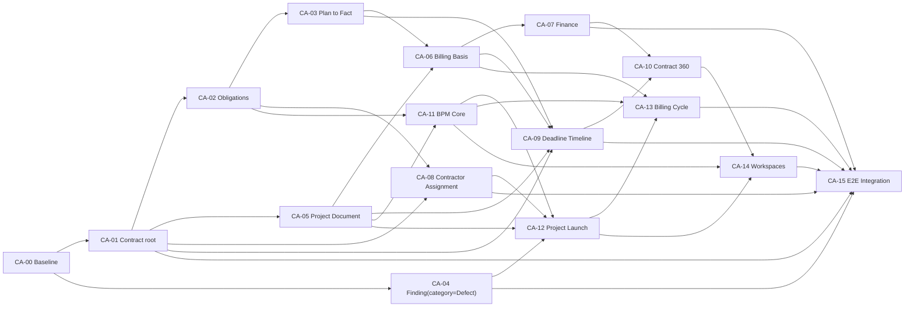

# 06. Roadmap внедрения системы учёта договоров

**Цель документа:** разложить переход от подтверждённой AS-IS модели к целевой системе учёта договоров на проверяемые инкременты `CA-00…CA-15`, определить MVP, зависимости, миграции, критерии приёмки и риски.

**Дата анализа:** 2026-08-17. **Решения синхронизированы:** 2026-08-18.

**Источник истины:** TARGET — `Structure of the contract accounting system.md`; требования и их назначение инкрементам — [04_coverage_matrix.csv](04_coverage_matrix.csv) и [07_traceability.csv](07_traceability.csv); AS-IS — [03_asis_model.md](03_asis_model.md); утверждённые owner decisions, оставшиеся вопросы и manual gates — [08_open_questions.md](08_open_questions.md). Целевая схема DocType должна быть сверена с [05_target_model.md](05_target_model.md).

**Как проверить:** импортировать [07_traceability.csv](07_traceability.csv), сгруппировать строки по `increment` и сопоставить диапазоны ниже; для каждого инкремента выполнить критерии и сохранить машинные/ручные доказательства; утверждённое решение не считать реализацией, а MG-CA gate — PASS без указанного evidence. Итоговую проверку отразить в [09_verification_report.md](09_verification_report.md).

## 1. Исходная точка и стратегия перехода

На дату discovery в Claude working tree найдено 54 DocType, но ключевые целевые узлы — `Ferum Contract Obligation`, `Ferum Finding/Defect`, `Ferum Project Document`, `Ferum Contractor Assignment`, `Ferum Contract Requirement`, BPM Template/Instance, `Ferum Stage Gate`, `Ferum Process Evidence`, `Ferum Inspection` и generic deadline/event engine — отсутствуют (`contract-accounting/03_asis_model.md:L11-L13`; `contract-accounting/03_asis_model.md:L326-L338`). AS-IS уже содержит рабочие контуры объектов, Scope/Schedule/Visit, заявок, billing и финансового read-model, поэтому переход должен быть аддитивным и сохранять их доказанные инварианты (`Вспомогательные/Claude ferum_custom/apps/ferum_custom/ferum_custom/services/maintenance_visit_generation.py:L131-L168`; `Вспомогательные/Claude ferum_custom/apps/ferum_custom/ferum_custom/services/maintenance_visit_generation.py:L527-L638`; `Вспомогательные/Claude ferum_custom/apps/ferum_custom/ferum_custom/services/project_finance_summary.py:L403-L701`).

Порядок реализации строится по следующим правилам:

> **Owner decision — 2026-08-18:** существующие данные приложения являются непродукционными тестовыми данными. Перенос legacy business records, исторических значений `Contract.status` и тестовой audit/status history в TARGET не требуется; тестовые записи могут быть сброшены или созданы заново. Migration logic не должна проектироваться только ради сохранения тестовых данных. При этом TARGET schema, lifecycle rules, integrity constraints и production-ready migration discipline для будущих релизов остаются обязательными.

- сначала фиксируется воспроизводимый baseline и закрываются незавершённые W2-гейты;

- миграции выполняются additive-first: новые поля и связи вводятся до переключения источника истины, старые зеркала удаляются только отдельным последующим решением;

- юридически значимые и неоднозначные данные не восстанавливаются эвристикой без очереди ручной сверки;

- стандартные `Customer`, `Supplier`, `Company`, `Sales Invoice`, `Purchase Invoice`, `Payment Entry`, `GL Entry`, `File`, `Communication`, `Assignment` и `ToDo` остаются ERPNext SSOT/инфраструктурой; кастомный слой не создаёт вторую бухгалтерию или второй диспетчер задач (`Вспомогательные/Claude ferum_custom/apps/ferum_custom/ferum_custom/hooks.py:L359-L403`; `Вспомогательные/Claude ferum_custom/apps/ferum_custom/docs/plan/owner_decisions_2026-08-17_target_structure.md:L68-L72`);

- автоматическое доказательство не заменяет UAT, юридическую проверку, решение владельца или стендовую DB-верификацию.

## 2. Сводный план инкрементов

| Инкремент | Название и результат | Закрываемые `req_id` | Зависимости | MVP | Оценка |
| --- | --- | --- | --- | --- | --- |
| `CA-00` | Baseline, границы ERPNext и миграционная готовность | `TCA-A-17-01…TCA-A-17-21` | — | Да | M |
| `CA-01` | Service Project как Contract root, объекты и двойные статусы | `TCA-A-01-01…TCA-A-01-25`; `TCA-A-02-01…TCA-A-02-13`; `TCA-A-03-01…TCA-A-03-12`; `TCA-A-13-01…TCA-A-13-06`; `TCA-A-18-01…02`; `TCA-A-18-04…05` | `CA-00`; утверждённый OQ-CA-003; MG-CA-016 для cutover | Да | XL |
| `CA-02` | Contract Requirement/Obligation для ответа «что, где, когда» | `TCA-A-04-01…TCA-A-04-08`; `TCA-A-18-03` | `CA-01` | Да | L |
| `CA-03` | Сквозной plan→fact и обратная трассировка | `TCA-A-05-01…TCA-A-05-09`; `TCA-A-06-01…TCA-A-06-16` | `CA-02` | Да | XL |
| `CA-04` | Самостоятельный Finding с категорией Defect | `TCA-A-07-01…TCA-A-07-08`; `TCA-A-18-06…TCA-A-18-10` | `CA-00`; интеграция с `CA-03` | Да | M |
| `CA-05` | Project Document и раздельные статусы копии/оригинала | `TCA-A-08-01…TCA-A-08-13`; `TCA-A-18-11`; `TCA-B-25-01…TCA-B-25-04` | `CA-01` | Да | L |
| `CA-06` | Исполнение→Billing Basis→акт/УПД→Sales Invoice | `TCA-A-09-01…TCA-A-09-08`; `TCA-A-10-01…TCA-A-10-03`; `TCA-A-18-15…TCA-A-18-16` | `CA-03`, `CA-05` | Да | XL |
| `CA-07` | Оплата, ДЗ, затраты и маржа из ERPNext SSOT | `TCA-A-11-01…TCA-A-11-15`; `TCA-A-18-14`; `TCA-A-18-17` | `CA-06` | Да | M |
| `CA-08` | Contractor Assignment и готовность исполнителей | `TCA-A-12-01…TCA-A-12-10`; `TCA-A-18-12…TCA-A-18-13` | `CA-01`, `CA-02`; MG-CA-015 для production Worker/Credential/readiness | После MVP | L |
| `CA-09` | Derived timeline контрольных сроков | `TCA-A-14-01…TCA-A-14-13` | `CA-01`, `CA-03`, `CA-05`, `CA-06`; MG-CA-013 до production calculation | После MVP | M |
| `CA-10` | Contract 360° и центр исключений | `TCA-A-15-01…TCA-A-15-08`; `TCA-A-16-01…TCA-A-16-19` | `CA-07`, `CA-09` | После MVP | L |
| `CA-11` | BPM Core: Requirement→Template→Process→Step→Evidence→Gate | `TCA-B-01…12-*`; `TCA-B-20-*`; `TCA-B-24-*`; `TCA-B-26…30-*`; `TCA-B-33…35-*`; `TCA-B-37…39-*` (169 точных ID в CSV) | `CA-02`, `CA-05` | После MVP | XL |
| `CA-12` | Семистадийный запуск, персонал и Inspection | `TCA-B-13…19-*`; `TCA-B-22…23-*` (84 точных ID в CSV) | `CA-04`, `CA-05`, `CA-08`, `CA-11` | После MVP | XL |
| `CA-13` | Первое закрытие периода и Billing Cycle Gate | `TCA-B-21-01…TCA-B-21-11` | `CA-06`, `CA-11`, `CA-12` | После MVP | L |
| `CA-14` | «Мои действия» и «Запуск проектов» | `TCA-B-31-01…TCA-B-31-05`; `TCA-B-32-01…TCA-B-32-09` | `CA-10`, `CA-11`, `CA-12` | После MVP | L |
| `CA-15` | Интеграционное укрепление и end-to-end trace | `TCA-A-19-01…TCA-A-19-23`; `TCA-A-20-01…TCA-A-20-14`; `TCA-B-36-01…TCA-B-36-14` | `CA-01…CA-14`; MG-CA-023 только для production Import Batch claim | Финальный gate | XL |

Диапазоны воспроизводят назначение всех 557 строк в [07_traceability.csv](07_traceability.csv); для длинных BPM-групп таблица использует wildcard по полностью перечисленным разделам, а точный перечень всех `req_id` хранится в CSV. Изменение состава инкрементов требует синхронного изменения этого CSV.

## 3. Граф зависимостей



`CA-04` и минимальное ядро `CA-05` допускают параллельную реализацию после baseline; технический порядок «Finding(category=Defect) → Project Document → BPM» не меняет зависимость MVP от Service Project/Obligation/plan-fact (`Structure of the contract accounting system.md:L350-L397`; `Вспомогательные/Claude ferum_custom/apps/ferum_custom/docs/plan/owner_decisions_2026-08-17_target_structure.md:L224-L242`).

## 4. MVP-контур

### 4.1. Состав MVP

MVP считается достигнутым только после приёмки `CA-00…CA-07`. Он должен дать операционный ответ на вопрос «что мы обязаны сделать по договору, когда и где» и доказуемую цепочку:

```text
Contract → Contract Obligation → Schedule/Planned Visit → Accepted Fact
→ immutable Billing Basis → Act/UPD + Sales Invoice → Payment Entry
→ Project Finance Summary
```

В MVP входят:

- единый `Ferum Service Project` как договорный root с независимыми `legal_status` и `execution_status`;

- объекты и системы договора;

- нормализованное обязательство с работой, местом, периодичностью, окном срока и effective dates;

- генерация планового события и его фактическое закрытие с evidence;

- `Ferum Finding(category=Defect)` для результата «обнаружено, но ещё не заявка и не выполненная работа»;

- единый реестр документов с раздельными статусами цифровой копии и бумажного оригинала;

- immutable snapshot оснований акта/УПД;

- стандартные Sales Invoice/Payment Entry/GL как бухгалтерский SSOT и кастомный Finance Summary как rebuildable read-model.

Полный BPM-конструктор, семистадийный launch, N:M contractor assignment, derived deadline center и финальные workspaces не являются условием первого MVP, но не должны блокироваться его моделью данных.

### 4.2. Сквозной критерий MVP

На тестовом договоре с двумя объектами и двумя системами система должна:

1. Показать обязательство «какая работа, на каком объекте/системе, в каком периоде и до какой даты».

2. Сгенерировать ровно одно плановое событие периода и сохранить обратную ссылку на обязательство.

3. Зафиксировать фактический визит, исполнителя, дату, checklist/evidence и решение приёмки.

4. Отдельно зарегистрировать обнаруженный `Ferum Finding(category=Defect)` и, при необходимости, создать связанную Service Request без потери исходного факта.

5. Подобрать только принятые и ещё не актированные работы, зафиксировать их в неизменяемом Billing Basis и сформировать акт/УПД.

6. Связать closing document со стандартным submitted Sales Invoice, затем со submitted Payment Entry.

7. Показать в Finance Summary начислено, оплачено, outstanding/overdue AR, затраты и маржу без прямой записи кастомного кода в GL.

8. Пройти от любой точки цепочки назад до договора/обязательства и вперёд до оплаты и маржи; разрыв ссылки является дефектом приёмки.

## 5. Инкременты

### CA-00. Baseline, ERPNext boundary и миграционная готовность

**Цель:** превратить текущий working tree в воспроизводимую исходную точку и зафиксировать стандартные/кастомные границы до изменения данных.

**AS-IS:** W2-T11 содержит integration-tested conditional unique keys, но стендовый W2-V02 и W2-T12 остаются отдельными ручными/следующими gates (`Вспомогательные/Claude ferum_custom/apps/ferum_custom/docs/plan/09_task_breakdown.md:L480-L515`). Длина generated-visit key требует именно стендового протокола, а не расчётного утверждения (`Вспомогательные/Claude ferum_custom/apps/ferum_custom/ferum_custom/patches/v0_2/add_unique_key_generated_visit.py:L20-L24`).

**Owner decision:** OQ-CA-016 утверждает первый clean post-W2 commit до TARGET implementation как baseline; Claude dirty tree и более старый неполный Codex snapshot им не являются. Решение не создаёт evidence: результатом CA-00 должен стать закрытый MG-CA-016 с SHA/clean tree/diff hash/versions/schema/configuration/DB gates.

**Состав:**

- freeze commit/tag baseline после закрытия согласованных W2-задач;

- inventory live schema, installed patches, Workflow, Custom Field, roles и Scheduled Job Type без чтения секретов;

- ADR по границе ERPNext/custom и Party Identity ownership;

- baseline dataset, rollback rehearsal и обязательный формат migration evidence;

- фиксация ручных gates: DB, UAT, legal и permission review.

**Миграция:** данных не переносит. Возможны только диагностические reconciliation reports. До W2-V02 нельзя считать DB uniqueness доказанной.

**Критерии приёмки:**

- commit/hash, версия schema и список применённых patches зафиксированы в release evidence;

- физические ключи W2 проверены на стенде протоколом владельца, включая duplicate-negative tests;

- documented boundary подтверждает отсутствие кастомной записи в GL и повторного master/accounting SSOT;

- rollback rehearsal восстанавливает schema/configuration baseline; сохранение или восстановление тестовых business records не является gate;

- все незакрытые ручные gates имеют owner и статус, а не ложный PASS.

**Оценка:** M.

### CA-01. Service Project как Contract root, объекты и двойные статусы

**Цель:** привести модель к TARGET: один `Ferum Service Project` является одним исполняемым договором, хранит юридические условия и оба независимых legal/execution lifecycle.

**AS-IS:** принят двухфазный переход через `Ferum Contract` и `Ferum Project Contract Link`; договорные поля проекта пока остаются зеркалами, а перенос SSOT отложен во вторую фазу (`Вспомогательные/Claude ferum_custom/apps/ferum_custom/docs/adr/ADR-0003-service-project-vs-legal-contract.md:L50-L69`). Amendment/Execution Stage/Security ещё project-centric, например Amendment хранит `service_project` (`Вспомогательные/Claude ferum_custom/apps/ferum_custom/ferum_custom/ferum_custom/doctype/ferum_contract_amendment/ferum_contract_amendment.json#service_project`).

**OQ-CA-003 — `APPROVED`, 2026-08-18:** legal FSM = Draft, On Approval, Approved, Signing, Signed, In Force, Cancelled, Terminated, Expired; execution FSM = Not Started, Launching, Active, Suspended, Completed, Stopped. Cancelled/Terminated/Expired и Completed/Stopped terminal; `Active` разрешён только при In Force; `Suspended→Completed` запрещён. OQ-CA-020 уточняет Resume: возврат только в сохранённый `suspended_from_status` Launching/Active. `Closed`/`Archived` вынесены из FSM. Полные matrices/audit rules зафиксированы в [05_target_model.md](05_target_model.md#4-двойная-статусная-модель-договора) и [08_open_questions.md](08_open_questions.md#oq-ca-003-какова-целевая-dual-status-fsm-договора). Legacy status migration не требуется.

**Статус реализации, 2026-08-18:** CA-01 CODE/schema v0.2.0 закрыт: contract root, dual FSM, typed audit, Amendment/Stage/Security/Financial Plan, Service Project→Project Object→Service Object→Object System, fail-closed integrity и controlled schema rollback/reinstall подтверждены на отдельном ERPNext v15 site: [runtime evidence](implementation/CA-01/runtime_evidence_v0_2_0_2026-08-18.md). Full backup restore, downstream Project Document/Scope/Billing/AR и ручные UAT/legal/finance gates остаются открыты и не маскируются статусом CA-01.

**Состав:**

- реализовать утверждённую OQ-CA-001/002 целевую топологию: один `Ferum Service Project` является Contract root, а ссылки Amendment, Stage, Security и других зависимых сущностей направлены на него; перенос существующих тестовых Contract↔Project записей не требуется;

- добавить `legal_status` и `execution_status` в `Ferum Service Project` по утверждённому OQ-CA-003 с server-side transition matrix, терминальными состояниями и взаимными ограничениями lifecycle;

- реализовать юридические поля и перевести schema-связи Amendment, Stage, Security и financial plan на `Ferum Service Project`;

- сохранить Service Project→Object→Object System navigation и проверить целостность новых прямых/reverse links без retention тестовых legacy records;

- ввести audit events для каждого нового статусного перехода, включая обязательные reason/evidence для досрочного отказа или прекращения договора.

- реализовать server-side Suspend/Resume исполнения по OQ-CA-020: хранить `suspended_from_status`, reason/actor/effective date/evidence; Resume возвращает только в прежний Launching/Active, terminal execution не возобновляется обычной командой.

**Миграция/patches:** тестовые legacy business records, исторический `Contract.status` и тестовая audit/status history не переносятся. TARGET fields, связи и конфигурация вводятся как clean schema; тестовые записи сбрасываются либо создаются заново. Для архитектурного cutover остаются обязательными schema/link reconciliation, проверка ссылочной целостности и управляемое переключение новой бизнес-логики; patch для mapping/backfill/dual-write старой status model не создаётся.

**Критерии приёмки:**

- каждый заново созданный тестовый Service Project имеет ровно один однозначный набор юридических условий и не зависит от `Ferum Contract` как второго SSOT;

- все допустимые legal/execution переходы проходят, все недопустимые блокируются сервером;

- direct edit `execution_status` не обходит FSM; Suspend/Resume имеет positive/negative tests для Launching и Active и не изменяет legal status;

- Cancelled/Terminated вместе с требуемым execution transition сохраняются атомарно; при ошибке обе оси остаются неизменными, а связанные audit events имеют общий correlation id;

- Cancelled/Terminated/Expired запрещают новое исполнение, но не скрывают незакрытую ДЗ, документы и историю исполнения; несостоявшийся договор переходит из Draft/On Approval/Approved/Signing только в Cancelled с обязательными reason/date/actor/comment/evidence по policy, а `Draft→Terminated` запрещён;

- Amendment меняет только effective-dated future/current state и сохраняет историю до/после;

- reset/recreate тестового набора не оставляет orphan links, а schema/configuration deployment и его controlled rollback повторяемы; обратного преобразования dual statuses в старый `Contract.status` нет.

**Оценка:** XL.

### CA-02. Contract Requirement и Contract Obligation

**Цель:** создать явный слой между договором и графиком, отвечающий на «что сделать, где, с какой периодичностью и когда».

**Статус реализации, 2026-08-18:** CA-02 core CODE/schema v0.3.0 реализован и подтверждён на отдельном ERPNext v15 site: Requirement assessment/routing, Contract Obligation, typed recurrence, effective-version/foreign-context guards, deterministic no-write preview, migrate и controlled schema reinstall — [runtime evidence](implementation/CA-02/runtime_evidence_v0_3_0_2026-08-18.md). Schedule/Visit writer для `TCA-A-04-07…08` теперь реализован следующим инкрементом CA-03 v0.4.0; SLA/Holiday timestamp engine (CA-09), Project Document Link (CA-05), one-time Process Step writer (CA-11) и legacy combined-app migration gate остаются открыты. Исторический точный статус v0.3.0 — [implementation traceability](implementation/CA-02/traceability_v0_3_0.md).

**AS-IS:** `Ferum Project Scope` содержит правило работ/периодичности, а генератор создаёт визиты из Scope/Schedule, но отдельного `Ferum Contract Obligation` нет (`Вспомогательные/Claude ferum_custom/apps/ferum_custom/ferum_custom/ferum_custom/doctype/ferum_project_scope/ferum_project_scope.json#work_type`; `Вспомогательные/Claude ferum_custom/apps/ferum_custom/ferum_custom/services/maintenance_visit_generation.py:L527-L638`; `contract-accounting/03_asis_model.md:L326-L328`). Requirement, одноразовый Process Step и повторяющийся Scope нормативно разделены (`Вспомогательные/Claude ferum_custom/apps/ferum_custom/docs/plan/owner_decisions_2026-08-17_target_structure.md:L74-L94`).

**Состав:**

- `Ferum Contract Requirement` с источником, цитатой/ссылкой, применимостью и решением маршрутизации;

- `Ferum Contract Obligation` с единым `service_project`, Project Object, Object System, work type, frequency/deadline rule, effective dates, criticality и source requirement;

- правила один requirement→одноразовый step либо recurring obligation без дублирования;

- reverse trace Service Project/Requirement/Obligation/Scope/Schedule.

**Миграция/patches:** построить draft obligations из активных effective-dated Scope только при однозначных Service Project/Object System/work type; legacy Contract используется лишь как read-only migration provenance, неоднозначные строки направляются на review. Уникальность active obligation защитить сервером и, после DB-пробы, условным ключом.

**Критерии приёмки:**

- каждое active recurring Scope имеет ровно одно применимое обязательство либо документированное исключение;

- обязательство однозначно отвечает на work/object/system/frequency/deadline/effective period;

- изменение существенных условий создаёт новую effective version, не переписывает прошлое;

- generation preview показывает будущие периоды без создания дублей;

- повторный migration/generation прогон идемпотентен.

**Оценка:** L.

### CA-03. Сквозной plan→fact

**Цель:** связать Obligation→Schedule/Planned Event→Maintenance Visit и Service Request с доказательствами и обратной трассировкой.

**Статус реализации, 2026-08-18:** CA-03 core CODE/schema v0.4.0 реализован и подтверждён на отдельном ERPNext v15 site: unique Obligation/period Schedule, idempotent Schedule+primary Visit generation, explicit cancelled replacement, planned/actual split, checklist/private File evidence, PM review/acceptance, immutable accepted fact, самостоятельный Service Request и reverse trace — [runtime evidence](implementation/CA-03/runtime_evidence_v0_4_0_2026-08-18.md). Act/Invoice/Payment chain (`TCA-A-05-06…08`) остаётся CA-06/07, Finding link — CA-04, assigned-contractor/portal scoping — CA-08; [implementation traceability](implementation/CA-03/traceability_v0_4_0.md) не подменяет эти OPEN gates.

**AS-IS:** генератор уже поддерживает period/frequency/Holiday List и idempotency по `contract/object_system/work_type/period_key`; Visit и Service Request имеют отдельные FSM и evidence/SLA gates (`Вспомогательные/Claude ferum_custom/apps/ferum_custom/ferum_custom/services/maintenance_visit_generation.py:L131-L168`; `Вспомогательные/Claude ferum_custom/apps/ferum_custom/ferum_custom/services/maintenance_visit_generation.py:L527-L638`; `Вспомогательные/Claude ferum_custom/apps/ferum_custom/ferum_custom/ferum_custom/doctype/ferum_maintenance_visit/ferum_maintenance_visit.py:L111-L163`; `Вспомогательные/Claude ferum_custom/apps/ferum_custom/ferum_custom/ferum_custom/doctype/ferum_maintenance_visit/ferum_maintenance_visit.py:L442-L529`; `Вспомогательные/Claude ferum_custom/apps/ferum_custom/ferum_custom/ferum_custom/doctype/ferum_service_request/ferum_service_request.py:L312-L420`; `Вспомогательные/Claude ferum_custom/apps/ferum_custom/ferum_custom/ferum_custom/doctype/ferum_service_request/ferum_service_request.py:L450-L557`).

**Состав:**

- добавить обязательную provenance-связь планового исполнения с Obligation и period key;

- разделить planned date/window и actual start/finish;

- нормировать assignee/contractor, report, checklist, photo/evidence и acceptance;

- обеспечить reverse navigation от факта к плану, obligation, object/system и contract;

- сохранить внеплановую Service Request отдельным путём.

**Миграция/patches:** backfill obligation по существующему contract/object_system/work_type/effective period; неоднозначные визиты не связывать автоматически. Не нарушать `idx_generated_visit_uniq`; до cutover выполнить W2-V02 и duplicate rehearsal.

**Критерии приёмки:**

- одно обязательство генерирует ровно одно плановое событие на period key;

- cancelled generated visit не создаёт молча второй generated fact; повторное покрытие выполняется нормативным сценарием;

- Accepted visit невозможен без обязательных checklist/evidence/review;

- Service Request остаётся самостоятельным внеплановым фактом;

- end-to-end query возвращает plan/fact deviation и полный reverse trace.

**Оценка:** XL.

### CA-04. Finding с категорией Defect

**Цель:** отделить обнаруженное замечание от заявки и выполненной работы.

**AS-IS:** отдельного Finding/Defect нет; `Service Request.request_type` содержит лишь тип заявки (`Вспомогательные/Claude ferum_custom/apps/ferum_custom/ferum_custom/ferum_custom/doctype/ferum_service_request/ferum_service_request.json#request_type`; `contract-accounting/03_asis_model.md:L326-L329`). По утверждённому OQ-CA-005 целевая модель использует самостоятельный `Ferum Finding` с `category=Observation/Defect/Nonconformity/Risk`, альтернативным source Visit/Inspection, object/system, severity, evidence, resolution и optional execution link на Service Request/утверждённый work-order adapter; отдельный Defect не вводится (`Structure of the contract accounting system.md:L350-L397`; [05_target_model.md](05_target_model.md#30-решение-findingdefect)).

**Состав:** Finding lifecycle, category/severity, detected context snapshot, photos/files, confirmation/resolution class, owner, due/closed dates и links to generated Service Request.

**Миграция/patches:** не преобразовывать существующие Service Request в Finding автоматически. Разрешён только candidate report по request type/text с ручным подтверждением категории Defect; provenance исходной записи обязательна.

**Критерии приёмки:**

- Finding создаётся из Visit/Inspection без автоматического создания заявки;

- создание связанной Service Request не меняет исходные данные Finding;

- close запрещён без resolution, evidence и обязательных дат;

- отчёт показывает open critical, overdue и без решения;

- permissions исключают доступ подрядчика к чужим проектам.

**Результат реализации v0.5.0 — 2026-08-18:** `CA-04 CORE CODE COMPLETE / BENCH VERIFIED`. Реализованы один physical `Ferum Finding` без Defect DocType, обязательная category, immutable Visit provenance/context snapshot, confirmation/resolution FSM, idempotent Service Request execution links, explicit request creation, derived exception report и `Ferum Photo Evidence` с review/hash стандартного File. Migrate и clean reinstall 21 DocType прошли; standalone suite `72/72`, полный Frappe suite до и после reinstall `24/24`. Inspection source остаётся fail-closed до CA-12; contractor role сейчас не получает доступа, а положительная own-assignment row-level модель остаётся CA-08; work-order adapter не разрешён. Legacy Service Request автоматически не преобразуются, candidate conversion не запускался из-за отсутствия legacy records на disposable site. Evidence: [implementation/CA-04/README.md](implementation/CA-04/README.md), [runtime evidence](implementation/CA-04/runtime_evidence_v0_5_0_2026-08-18.md), [traceability](implementation/CA-04/traceability_v0_5_0.md).

**Оценка:** M.

### CA-05. Project Document и оригиналы

**Цель:** дать единый реестр договорных/проектных документов и раздельный контроль цифровой копии и бумажного оригинала.

**AS-IS:** billing-файлы версионируются `Ferum Billing Artifact`, но универсального Project Document и `original_status`/`digital_copy_status` нет (`Вспомогательные/Claude ferum_custom/apps/ferum_custom/ferum_custom/ferum_custom/doctype/ferum_billing_artifact/ferum_billing_artifact.json#artifact_type`; `contract-accounting/03_asis_model.md:L326-L330`). Project Document должен ссылаться на billing artifact, а не копировать его SSOT (`Вспомогательные/Claude ferum_custom/apps/ferum_custom/docs/plan/owner_decisions_2026-08-17_target_structure.md:L121-L134`).

**Состав:** Project Document, document type, Service Project/Object links, number/date/version/validity, source, files/related entity, `digital_copy_status`, `original_status`, shipment/tracking and status transition rules.

**Миграция/patches:** создать ссылки-представления для Billing Artifact и кандидаты из attached File. Не присваивать `Received/Archived` бумажному оригиналу без доказательства; неизвестные случаи — migration issue/manual review. Deduplication по source doctype/name/version/file hash.

**Критерии приёмки:**

- цифровая копия и оригинал изменяются независимо по серверной матрице;

- `Not Required` требует нормативного основания, а `Received/Archived` — evidence/stamp;

- один billing artifact не дублируется вторым физическим файлом;

- file access/lock предотвращает удаление accepted/signed/legal archive evidence;

- документ доступен из единого Service Project, Project Object и связанного процесса; legacy Contract остаётся только provenance до cutover.

**Оценка:** L.

### CA-06. Billing Basis, акт и счёт

**Цель:** доказуемо связать исполнение с актом/УПД и стандартным Sales Invoice.

**AS-IS:** Billing Output имеет только одиночный `basis_service_request`; Output/Artifact/Event уже реализуют lifecycle, versioning и immutable audit (`Вспомогательные/Claude ferum_custom/apps/ferum_custom/ferum_custom/ferum_custom/doctype/ferum_billing_output/ferum_billing_output.json#basis_service_request`; `Вспомогательные/Claude ferum_custom/apps/ferum_custom/ferum_custom/ferum_custom/doctype/ferum_billing_output/ferum_billing_output.py:L162-L387`; `Вспомогательные/Claude ferum_custom/apps/ferum_custom/ferum_custom/ferum_custom/doctype/ferum_billing_artifact/ferum_billing_artifact.py:L98-L267`). Принята гибридная модель derived selection + immutable `Billing Basis Item[]` snapshot (`Вспомогательные/Claude ferum_custom/apps/ferum_custom/docs/plan/owner_decisions_2026-08-17_target_structure.md:L146-L164`).

**Состав:** derived candidate selector, Billing Basis child rows для Visit/Request/other accepted result и period key, immutable snapshot on issue, unbilled accepted work report, supersede/correction lifecycle, link to submitted Sales Invoice.

**Миграция/patches:** для Draft/Generated outputs basis можно восстановить и проверить. Для Issued/Signed — только однозначный backfill; конфликт уходит в legal review, существующий snapshot/артефакт не переписывается. При изменении print snapshot schema увеличить версию и сохранить совместимость старых snapshots.

**Критерии приёмки:**

- selector предлагает только accepted, применимые и ещё не включённые в active closing document результаты;

- Issued/Signed output имеет непустой immutable basis snapshot;

- один execution result не попадает в два активных closing documents;

- correction/supersede сохраняет историю старого и нового basis;

- отчёт «принято, но не актировано» сходится с basis rows;

- Sales Invoice и Payment Entry остаются стандартными ERPNext документами.

**Оценка:** XL.

### CA-07. Финансы, оплата и маржа

**Цель:** завершить MVP до оплаты и экономического результата без второй бухгалтерии.

**AS-IS:** `Ferum Project Finance Summary` уже является service-managed read-model на Sales/Purchase Invoice, Payment Entry и подтверждённых затратах; кастомный CODE не пишет прямые GL entries (`Вспомогательные/Claude ferum_custom/apps/ferum_custom/ferum_custom/services/project_finance_summary.py:L403-L701`; `Вспомогательные/Claude ferum_custom/apps/ferum_custom/ferum_custom/hooks.py:L359-L403`).

**Состав:** добавить obligation/billing-cycle dimensions в read-model, выверить recognized/invoiced/paid/outstanding/overdue/cost/margin, reconciliation alerts и портфельные rollup по Company/Customer/manager поверх единого `Ferum Service Project`-договора.

**Миграция/patches:** полный rebuild, before/after comparison с submitted ERPNext documents, отдельный список расхождений; никаких корректирующих GL проводок миграционным patch.

**Критерии приёмки:**

- paid и outstanding сходятся со стандартными submitted Invoice/Payment Entry на контрольной выборке;

- opening balances учитываются по нормативу без двойного revenue;

- один Purchase Invoice не заявлен одновременно как material и contractor cost;

- портфельный rollup равен сумме Service Project с документированными правилами валюты и не создаёт второго Contract-root;

- rebuild повторяем и не изменяет бухгалтерские документы/GL.

**Результат реализации v0.8.0 — 2026-08-18:** `CA-07 CORE CODE COMPLETE / BENCH VERIFIED`. Реализованы service-managed `Ferum Project Finance Summary`, standard Sales/Purchase Invoice adapters, Payment Entry trace, opening-balance rule, guarded `Ferum Material Expense`/`Ferum Contractor Settlement`, exact PI classification, reconciliation и Company-currency portfolio rollup. Migrate и clean reinstall 31 DocType прошли; standalone suite `89/89`, полный Frappe suite до и после reinstall `41/41`. Положительный VAT tax-row сценарий и отдельная tool/rent аналитика остаются PARTIAL; legacy comparison, async worker/load/race, Finance UAT/sign-off и production deployment не выполнялись. Evidence: [implementation/CA-07/README.md](implementation/CA-07/README.md), [runtime evidence](implementation/CA-07/runtime_evidence_v0_8_0_2026-08-18.md), [traceability](implementation/CA-07/traceability_v0_8_0.md).

**Оценка:** M.

### CA-08. Contractor Assignment и готовность исполнителей

**Цель:** отделить операционное назначение подрядчика от цены и settlement.

**AS-IS:** contractor portal изолирует записи по Supplier/User Permission, но `Ferum Contractor Assignment` отсутствует; `Ferum Contractor Settlement` хранит только расчётную связь Supplier/Project/Scope (`Вспомогательные/Claude ferum_custom/apps/ferum_custom/ferum_custom/services/contractor_portal_isolation.py:L134-L268`; `Вспомогательные/Claude ferum_custom/apps/ferum_custom/ferum_custom/ferum_custom/doctype/ferum_contractor_settlement/ferum_contractor_settlement.json#supplier`; `Вспомогательные/Claude ferum_custom/apps/ferum_custom/ferum_custom/ferum_custom/doctype/ferum_contractor_settlement/ferum_contractor_settlement.json#project_scope`; `contract-accounting/03_asis_model.md:L326-L331`). Целевая размерность — Service Project×Object×System×Work Type×Period с отдельными коммерческими условиями (`Вспомогательные/Claude ferum_custom/apps/ferum_custom/docs/plan/owner_decisions_2026-08-17_target_structure.md:L166-L176`).

**Owner decision:** OQ-CA-015 утверждает Employee для staff, protected Contractor Worker для внешних исполнителей и holder allowlist/XOR.

**Входной gate:** MG-CA-015 должен предоставить правовое основание, consent, retention, protected-field allowlist и матрицу доступа/export/delete. До его закрытия допустим только schema/privacy spike без production Worker/Credential data и без включения PERSONNEL READY gate.

**Состав:** effective-dated Assignment; новый защищённый `Ferum Contractor Worker` и единый `Ferum Personnel Credential` с allowlist Employee/Contractor Worker; contractor/personnel links, scope/territory, responsibility, status и expiry; optional pricing/settlement reference без обязательной цены. Production protected fields включаются только после MG-CA-015 и не выдаются в supplier portal.

**Миграция/patches:** кандидаты из прямых contractor links на Visit/Request создаются только при непротиворечивом диапазоне; конфликтующие Supplier/period — manual review. Worker, квалификации и паспортные сведения не восстанавливать из свободного текста; внешнего работника создавать только из однозначного Supplier-scoped identifier, иначе оставлять migration candidate.

**Критерии приёмки:**

- на одну работу можно назначить разных подрядчиков по объекту/системе/периоду без overlap-конфликта;

- Assignment создаётся до согласования цены;

- недействующая квалификация блокирует readiness gate, но не стирает историческое назначение;

- один и тот же readiness gate одинаково проверяет Employee и Contractor Worker, а protected passport fields недоступны подрядчику и обычным проектным ролям;

- settlement и margin показывают assignment/commercial basis раздельно;

- portal permission tests доказывают Supplier isolation.

**Результат реализации v0.9.0 — 2026-08-18:** `CA-08 PARTIAL / ASSIGNMENT-COMMERCIAL CORE BENCH VERIFIED`. Реализованы effective-dated Assignment, Internal/Contractor XOR schema, object/system/work-type scope, overlap guard, отдельные Commercial Terms с derived margin, связи Settlement/Material и Supplier-isolated contractor read. Worker/Credential установлены только как fail-closed schema/privacy spike: records/API/readiness заблокированы, паспортных полей нет, `PERSONNEL READY` не включён. Migrate и clean reinstall 35 DocType прошли; standalone suite `96/96`, полный Frappe suite до и после reinstall `47/47`. Employee positive runtime, cross-entity portal access, legacy migration, load/race, HR/privacy/legal UAT/sign-off и production deployment остаются OPEN; MG-CA-015 не закрыт. Evidence: [implementation/CA-08/README.md](implementation/CA-08/README.md), [runtime evidence](implementation/CA-08/runtime_evidence_v0_9_0_2026-08-18.md), [traceability](implementation/CA-08/traceability_v0_9_0.md).

**Оценка:** L.

### CA-09. Derived deadline timeline

**Цель:** объединить контрольные даты договора без преждевременного создания ещё одного SSOT.

**AS-IS:** сроки распределены между Contract/Security, SLA, billing, payment due и документами. Принято сначала создать read-only `Contract Deadline View / Timeline`, а BPM должен владеть собственными warning/due/escalation dates (`Вспомогательные/Claude ferum_custom/apps/ferum_custom/docs/plan/owner_decisions_2026-08-17_target_structure.md:L178-L187`).

**Owner decision:** OQ-CA-013 утверждает Company timezone, Project/Contract Holiday List override и immutable snapshot calendar revision; точные production values/cut-off должны быть доказаны MG-CA-013.

**Состав:** адаптеры источников дат, normalized kind/source/owner/date/status/severity, due-soon/overdue rules, links to source, notification/escalation projection и Contract 360 API.

**Миграция/patches:** данные не копируются; создаются indexes/materialized cache только при измеренной необходимости. `Ferum Contract Milestone` не создавать без отдельного подтверждённого use case.

**Критерии приёмки:**

- каждая строка timeline имеет первичный source doctype/name и не редактируется как отдельный факт;

- Contract expiry, security, SLA, billing, payment, document и BPM dates попадают в нормализованный view;

- изменение source отражается после rebuild без orphan/duplicate;

- overdue/warning вычисляются по утверждённому precedence и зафиксированному MG-CA-013 calendar/holiday fixture;

- query latency укладывается в согласованный бюджет на репрезентативном объёме.

**Результат реализации v0.10.0 — 2026-08-18:** `CA-09 PARTIAL / SOURCE TIMELINE BENCH VERIFIED`. Реализованы read-only normalized projection с точным `source_doctype/name/field`, source fingerprint и adapters Contract, Maintenance, Request, Stage acceptance/billing/payment, Security/Bank Guarantee, Project Document, Finding и submitted Sales Invoice; отдельный `Ferum Deadline/Milestone` не создан. Pure calendar engine требует явный immutable timezone/revision/holiday/cut-off snapshot и fail-closed отклоняет неизвестный trigger/config. Без `as_of` классификация выключена, а production warning/escalation остаётся `disabled_pending_MG-CA-013`. Migrate сохранил 35 DocType; standalone suite `100/100`, targeted Frappe `3/3`, полный suite `50/50`. Signature/customer-response/general-warranty source fields, BPM dates, representative-volume latency, notification delivery, UAT/sign-off и production deployment остаются OPEN; MG-CA-013 не закрыт. Evidence: [implementation/CA-09/README.md](implementation/CA-09/README.md), [runtime evidence](implementation/CA-09/runtime_evidence_v0_10_0_2026-08-18.md), [traceability](implementation/CA-09/traceability_v0_10_0.md).

**Оценка:** M.

### CA-10. Contract 360° и exception center

**Цель:** дать руководителю целостную read-only картину договора и отклонений без дублирования SSOT.

**AS-IS:** финансовые данные уже доступны из Finance Summary, но единого Contract 360/Director Control Center нет. Приняты три представления и правило вести каждый агрегат к первичной записи (`Вспомогательные/Claude ferum_custom/apps/ferum_custom/docs/plan/owner_decisions_2026-08-17_target_structure.md:L189-L213`).

**Состав:** Service Project «Контракт 360°», widgets objects/systems, obligations, plan/fact, findings/defects, documents, deadlines, billing, AR, costs/margin, contractors; director exceptions с owner, age, severity и drill-down.

**Миграция/patches:** отсутствует; только read-model/cache. Денежные поля сохраняют permlevel и role restrictions.

**Критерии приёмки:**

- каждое число/исключение имеет drill-down к первичным данным;

- карточка не выполняет самостоятельные финансовые расчёты;

- директор видит overdue, blocked, missing evidence, unsigned/unreceived documents, AR и margin anomalies;

- роли без финансового доступа не получают суммы через API/export/cache;

- агрегаты проходят reconciliation с source reports.

**Оценка:** L.

### CA-11. BPM Core

**Цель:** реализовать versioned универсальный процессный слой, не создавая второй task manager.

**AS-IS:** запуск проекта моделируется hard-coded API, а Process Template/Stage/Step, Contract Requirement, Process Evidence и Stage Gate отсутствуют (`Вспомогательные/Claude ferum_custom/apps/ferum_custom/ferum_custom/api/projects.py:L265-L342`; `contract-accounting/03_asis_model.md:L326-L336`). Утверждённые OQ-CA-010/011 фиксируют отдельные parent DocType Template/Stage/Step, Project Process/Stage/Process Step, Stage Gate/Evidence и JSON Logic allowlist/no eval; переход к child topology возможен только новым ADR с обновлением модели и трассировки (`Structure of the contract accounting system.md:L1001-L1069`; [05_target_model.md](05_target_model.md#3-новые-doctype)).

**Owner decision:** OQ-CA-012 утверждает persisted base `status` + derived `is_overdue/overdue_since/display_status`; отдельный persisted `Overdue` не вводится.

**Состав:**

- versioned `Ferum Process Template`, `Ferum Stage Template` и `Ferum Step Template` как parent DocType;

- `Ferum Project Process`, `Ferum Project Stage` и `Ferum Project Process Step` как parent instances;

- Requirement assessment, applicable template selection и idempotent generator;

- `deadline_type`, trigger/offset/unit/calendar, condition/activation, responsible role/assignee;

- criticality/blocking, evidence types, Waiting External/timeout action, warning/escalation;

- статусы и переходы, включая Blocked и Not Applicable с обязательной причиной;

- Process Evidence и Stage Gate evaluator;

- integration adapters к Assignment/ToDo, Communication, File, ERP documents и payments.

**Миграция/patches:** опубликованные template versions immutable. Новые проекты получают актуальную версию; открытые проекты — preview + explicit owner confirmation. Hard-coded historical steps не объявляются Completed без evidence.

**Критерии приёмки:**

- изменение шаблона создаёт новую версию и не меняет активный instance;

- один и тот же generation request не создаёт второй process/step;

- relative deadline корректно вычисляется от trigger event с выбранным calendar;

- Waiting External запускает warning/timeout action; timeout не завершает шаг без нормативного основания;

- Not Applicable невозможен без причины, Completed — без требуемого evidence;

- один незакрытый blocking condition даёт failed Gate и запрещает следующий stage;

- персональная работа отображается через стандартный Assignment/ToDo, а Process Step остаётся процессным SSOT;

- permission/audit/negative transition tests покрывают все статусы.

**Оценка:** XL.

### CA-12. Семистадийный запуск и Inspection

**Цель:** настроить эталонный launch-процесс от инициации до готовности к первому закрытию периода.

**AS-IS:** отдельного `Ferum Inspection` и lifecycle первичного обследования нет; Checklist Template является лишь шаблоном вопросов (`Вспомогательные/Claude ferum_custom/apps/ferum_custom/ferum_custom/ferum_custom/doctype/ferum_checklist_template/ferum_checklist_template.py:L1-L16`; `contract-accounting/03_asis_model.md:L326-L337`).

**Состав:** template стадий Initiation, Customer Contact, Execution Scheme, Personnel Readiness, Mobilization, Initial Inspection, Launch Readiness; Inspection snapshot/report/outcome; generation `Ferum Finding(category=Defect)`/Additional Work; после MG-CA-015 — personnel/contractor/document gates для Employee и Contractor Worker; evidence packs.

**Миграция/patches:** существующие active projects получают launch assessment, но история не генерируется автоматически. Completed/NA status разрешён только после ручного/evidence-backed mapping. Existing checklist results связываются с Inspection только однозначным patch.

**Критерии приёмки:**

- применимые стадии/шаги генерируются из Contract Requirement и template version;

- personnel gate не проходит без Assignment, действующих credentials и обязательных документов ни для Employee, ни для Contractor Worker;

- Inspection хранит состояние объекта/систем, evidence, outcome и дату snapshot;

- `Ferum Finding(category=Defect)`/Additional Work создаются из Inspection без потери исходного результата и повторный event не создаёт дубль;

- launch readiness не наступает при одном failed blocking gate;

- пилот проходит на B2G, B2B и subcontract сценариях с документированными различиями.

**Оценка:** XL.

### CA-13. Первое закрытие периода и Billing Cycle

**Цель:** завершить стадию запуска проверяемой готовностью первого закрывающего комплекта.

**AS-IS:** Billing Output связан с invoice/request, но самостоятельного Billing Cycle Gate нет (`Вспомогательные/Claude ferum_custom/apps/ferum_custom/ferum_custom/ferum_custom/doctype/ferum_billing_output/ferum_billing_output.json#sales_invoice`; `Вспомогательные/Claude ferum_custom/apps/ferum_custom/ferum_custom/ferum_custom/doctype/ferum_billing_output/ferum_billing_output.json#basis_service_request`; `contract-accounting/03_asis_model.md:L326-L338`).

**Состав:** Billing Cycle, period, expected/accepted work, billing basis readiness, document set, issue/sign/send/original receipt/payment milestones и stage gate.

**Миграция/patches:** backfill cycles из execution periods и active billing outputs только при однозначном period key. Issued/Signed output не менять; conflicts — manual legal reconciliation.

**Критерии приёмки:**

- цикл показывает expected, accepted, unbilled, billed, signed, sent и paid state;

- Gate первого периода закрывается только при выполнении применимых blocking условий;

- cycle→basis→output→invoice→payment имеет двустороннюю трассировку;

- correction/supersede не теряет историю цикла;

- overdue action попадает в My Actions/Director Center.

**Оценка:** L.

### CA-14. «Мои действия» и «Запуск проектов»

**Цель:** превратить процессные и операционные источники в управляемые рабочие очереди.

**AS-IS:** портал имеет отдельные выборки заявок/визитов/settlements, но не единый My Actions/Launch Projects workspace (`Вспомогательные/Claude ferum_custom/apps/ferum_custom/ferum_custom/api/portal.py:L764-L805`). Целевые источники и сортировка определены owner decision (`Вспомогательные/Claude ferum_custom/apps/ferum_custom/docs/plan/owner_decisions_2026-08-17_target_structure.md:L196-L204`).

**Состав:** Project Launch UI, My Actions, Launch Projects, фильтры overdue/today/upcoming/blocked/waiting external, bulk-safe navigation, role views и drill-down.

**Миграция/patches:** отсутствует; построение поверх BPM Step, Assignment/ToDo, Request, Visit, approvals и documents. Cache не становится SSOT.

**Критерии приёмки:**

- одна операция не дублируется как независимые задачи из Step и ToDo;

- пользователь видит только свои/делегированные действия и разрешённые проекты;

- priority ordering воспроизводимо сортирует overdue→today→upcoming и отдельно blocked/waiting;

- Launch Projects показывает failed gate и конкретные blocking conditions;

- deep links ведут к process/source/evidence без потери фильтра/контекста.

**Оценка:** L.

### CA-15. Интеграционное укрепление и сквозная трассировка

**Цель:** доказать, что целевая модель образует одну систему, а не набор несвязанных DocType.

**AS-IS:** Finance Summary уже агрегирует стандартные invoices/payments, а Audit/File Lock дают сервисный контроль, но полная TARGET-цепочка отсутствует (`Вспомогательные/Claude ferum_custom/apps/ferum_custom/ferum_custom/services/project_finance_summary.py:L403-L701`; `Вспомогательные/Claude ferum_custom/apps/ferum_custom/ferum_custom/ferum_custom/doctype/ferum_audit_log/ferum_audit_log.py:L14-L47`; `Вспомогательные/Claude ferum_custom/apps/ferum_custom/ferum_custom/ferum_custom/doctype/ferum_file_lock/ferum_file_lock.py:L16-L66`).

**Состав:** target ER conformance, cross-module permissions, audit/events, reconciliation, performance/indexes, migration closure, end-to-end dashboards и acceptance pack; field-level disposition Codex-only fields по OQ-CA-022; Import Batch runtime claim только после MG-CA-023.

**Миграция/patches:** orphan/duplicate reports, backfill provenance, controlled cutover feature flags, rollback scripts, archive старых зеркал только после retention/legal approval. Удаление данных не входит без отдельного разрешения.

**Критерии приёмки:**

- система отвечает на цепочку «почему возникло → где → когда → кто → что сделано → чем подтверждено → что выставлено → что оплачено → сколько заработали»;

- каждая ссылка проходит forward/reverse integrity check, orphan count равен нулю либо имеет утверждённый exception;

- permission matrix закрывает customer/contractor/PM/finance/director boundaries, включая API/export/report;

- scheduler/retry/idempotency tests не создают дубликаты;

- Import Batch либо проходит MG-CA-023 E2E `create→start→process→success/failure→retry/rollback/audit` через поддерживаемый entrypoint, либо явно остаётся inactive/not production-proven и не входит в release capabilities;

- миграционный dry-run, cutover rehearsal и rollback имеют отдельные evidence artifacts;

- все 557 `req_id` имеют acceptance criterion и owner в [07_traceability.csv](07_traceability.csv), а оставшиеся вопросы и MG gates — в [08_open_questions.md](08_open_questions.md).

**Оценка:** XL.

## 6. Миграционная стратегия и обязательные patches

| Этап | Patch/reconciliation | Fail-closed правило | Rollback/контроль |
| --- | --- | --- | --- |
| `CA-00` | Инвентаризация schema/patches/workflows и W2-V02 | Нет runtime PASS без стендового протокола | Baseline backup + rollback rehearsal |
| `CA-01` | TARGET legal fields, утверждённая dual-status schema/configuration и перевод связей на Service Project root; тестовые записи reset/recreate | Только переходы и cross-state пары OQ-CA-003; legacy `Contract.status` и audit history не переносятся | Controlled rollback только schema/configuration, feature flag, новой логики и новых связей; обратного mapping в 12-state model нет |
| `CA-02` | Scope→Obligation candidates | Создавать только при однозначных Contract/Object/System/effective dates | Idempotency key + candidate report |
| `CA-03` | Visit/Schedule→Obligation provenance | Не нарушать generated-visit unique key; неоднозначные facts в review | Revert links, не удаляя факты |
| `CA-04` | Request→Finding(category=Defect) candidate report | Никакой автоматической семантической конверсии текста | Delete only unconfirmed generated Finding candidates |
| `CA-05` | File/Billing Artifact→Project Document references | Не присваивать статус бумажного оригинала без evidence | Удалить projection/link, не физический File/Artifact |
| `CA-06` | Billing Basis backfill | Issued/Signed basis не переписывать при неоднозначности | Supersede/correction, не in-place rewrite |
| `CA-07` | Full Finance Summary rebuild | Никогда не создавать correction GL Entry из migration patch | Rebuild from ERPNext source documents |
| `CA-08` | Contractor link→Assignment/Contractor Worker candidates | Не изобретать Worker identity, passport, qualification/price/effective period | Candidate rollback с сохранением source links; protected identity data не создаются |
| `CA-09` | Derived deadline projection | Timeline не редактируется и не становится SSOT | Drop/rebuild cache/view |
| `CA-11` | Existing project process preview | Не отмечать исторические steps Completed/NA без evidence/reason | Disable generated instance, сохранить audit |
| `CA-12` | Existing launch/inspection assessment | Не реконструировать обследование по checklist без однозначной связи | Manual review, source checklist неизменен |
| `CA-13` | Billing Cycle period backfill | Issued/Signed outputs не менять | Remove cycle link/projection, preserve legal document |
| `CA-15` | Provenance/orphan cleanup | Физическое удаление вне scope без отдельного approval | Feature-flag rollback + retained mirrors |

Каждый действительно необходимый data patch должен поддерживать dry-run, идемпотентный повторный запуск, счётчики `scanned/created/updated/skipped/conflict`, журнал ошибок без секретов и отдельный rollback/reconciliation report. Это правило не требует создавать patch для сохранения или переноса тестовых legacy status/history records.

## 7. Архитектурные риски

| Риск | Вероятность / влияние | Последствие | Митигация | Owner |
| --- | --- | --- | --- | --- |
| Не завершён перевод schema-связей на единый Service Project root | Высокая / критическое | Второй Contract SSOT или orphan links после cutover | `CA-01` ADR, schema/link inventory, integrity tests и запрет новых ссылок на retired root | Product Owner + Architect |
| Obligation дублирует Project Scope | Средняя / критическое | Два генератора одного ТО | Закрепить Requirement→Step либо Obligation→Scope; единый period/idempotency key | Domain Architect |
| BPM становится вторым task manager | Средняя / высокое | Дубли поручений и статусов | Process Step — process SSOT, Assignment/ToDo — персональная доставка | BPM Architect |
| Project Document дублирует Billing Artifact | Средняя / высокое | Несовпадающие версии юридического файла | Reference/projection, один physical file lifecycle | Document Owner |
| Deadline engine становится новым SSOT | Средняя / высокое | Расхождение дат с бизнес-документами | Только derived timeline; Milestone после отдельного use case | Architect |
| Party Identity reconciliation реализован как скрытый второй master | Средняя / высокое | Расхождение Customer/Supplier/Company и ошибочный auto-merge | OQ-CA-017: standard masters — SSOT; explicit reconciliation, field-specific one-way rules и idempotent no-ambiguous-merge tests | MDM Owner |
| Финансовый слой начинает писать GL | Низкая / критическое | Вторая бухгалтерия и неверная отчётность | ERPNext documents/GL — SSOT, кастомный слой read-model | Finance Owner |
| Gate подменяет server authorization | Средняя / критическое | Обход бизнес-переходов | Gate управляет стадией, controller отдельно валидирует документ | Security Architect |

## 8. Миграционные риски

| Риск | Вероятность / влияние | Митигация | Проверяемое доказательство |
| --- | --- | --- | --- |
| Dirty W2 working tree и неисполненный DB gate | Высокая / критическое | Freeze baseline только после W2-V02/W2-T12 | Commit hash + DB protocol + clean diff scope |
| Реализация отклоняется от утверждённой dual-status FSM | Средняя / критическое | Генерировать server policy/tests из versioned OQ-CA-003 matrix; запрещать UI-only transitions | Exact enum/matrix check + positive/negative server transition tests |
| Дубли Scope/Obligation/Visit | Средняя / критическое | Conditional unique key, dry-run duplicate report | Negative DB test + idempotent second run |
| Неизвестный статус бумажного оригинала | Высокая / высокое | Не ставить Received/Archived без evidence | Manual review report, zero inferred receipts |
| Backfill basis юридически выпущенного документа | Средняя / критическое | Только однозначный snapshot; legal review иначе | Issued/Signed hash unchanged |
| Потеря effective history | Средняя / критическое | Versioned rows, no in-place overwrite | Before/after temporal query tests |
| Drift Finance Summary после cutover | Средняя / высокое | Full rebuild и reconciliation по ERPNext | Difference report с утверждённым threshold |
| Permission leakage через report/API/cache | Средняя / критическое | Permission query tests на каждом read path | Negative tests для customer/contractor/non-finance |
| Existing projects получают ложный Completed process | Высокая / высокое | Preview/owner confirmation/evidence-backed mapping | Zero auto-completed steps without evidence |
| Rollback удаляет юридические артефакты | Низкая / критическое | Rollback только links/projections, не File/Billing Artifact | Hash/count до и после rollback |
| Import Batch ошибочно объявлен production-ready по наличию model/FSM | Высокая / высокое | MG-CA-023 runtime entrypoint + E2E; иначе capability inactive | Verified flow с success/failure/retry/rollback/audit либо явный NOT EVIDENCED |

## 9. Организационные риски

| Риск | Последствие | Митигация | Owner |
| --- | --- | --- | --- |
| Утверждённые FSM, Party Identity или VAT boundaries меняются без decision log | Неконтролируемый drift и противоречивая бизнес-логика | Versioned decision log; изменения только новым owner decision | Product Owner + Finance Owner |
| Юристы не определили статусы оригинала и evidence акта | Нельзя принять `CA-05/CA-06` | Legal workshop на реальных документах, утверждённая status/evidence matrix | Legal Owner |
| Операции не ведут Object/System/Scope качественно | Obligation и plan-fact недостоверны | Data stewardship, completeness dashboard, пилотные договоры | Operations Owner |
| Квалификации персонала не имеют владельца/реестра | Personnel Gate формален | Назначить HR/HSE owner, регламент обновления и expiry alerts | HR/HSE Owner |
| Подрядчики не готовы к новой матрице назначений | Workaround через свободный текст | Pilot, onboarding и portal UAT с 2–3 подрядчиками | Contractor Manager |
| Автотесты ошибочно принимаются за UAT/legal PASS | Ложная готовность релиза | Раздельные evidence gates и запрет синтетического approval | Release Manager |
| Scope creep превращает MVP в полный BPM | Поздняя ценность и риск незавершения | Gate MVP=`CA-00…CA-07`; BPM финансируется отдельной волной | Steering Committee |
| Нет владельца exception backlog | Просрочки видимы, но не устраняются | SLA/owner/escalation для каждого класса исключений | Operations Director |

## 10. Волны поставки и release gates

| Волна | Инкременты | Выходной результат | Gate перехода |
| --- | --- | --- | --- |
| 0. Freeze | `CA-00` | Воспроизводимый baseline и границы SSOT | W2/DB/manual evidence закрыты |
| 1. MVP data spine | `CA-01…CA-07` | «Что/когда/где» и plan→fact→act→invoice→payment→margin | Сквозной MVP-сценарий, migration rehearsal, UAT/legal/finance sign-off |
| 2. Control | `CA-08…CA-10` | Подрядчики, сроки, Contract 360 и exceptions | Permission/performance/data-quality gates |
| 3. Process | `CA-11…CA-14` | Versioned BPM, запуск, Billing Cycle, My Actions | Template/version/gate/timeout/evidence UAT |
| 4. Integration | `CA-15` | Полная целевая трассировка и release candidate | Все 557 `req_id` имеют результат; OQ-CA-003 закрыт утверждением TARGET `legal_status`/`execution_status` FSM и transition matrix, а не legacy mapping; применимые MG-CA gates имеют evidence; owner approval не подменяет UAT/legal/runtime |

Первый рекомендуемый исполнимый шаг — `CA-00`, параллельно с проектированием `CA-04` и минимального `CA-05`. Первый бизнес-значимый gate — не отдельный экран, а завершённый MVP data spine `CA-01…CA-07`.
